<p align="center">
  
</p>

<h3 align="center">An AAC app for nonverbal children that learns the child's own language from the people who love them.</h3>

<p align="center">
  Version 0.18 &middot; vanilla HTML, CSS and JavaScript &middot; no build step &middot; installable PWA &middot; WCAG 2.2 AA &middot; local-first
</p>

<p align="center">
  <strong>Try it:</strong> <a href="https://luminaac-web.vercel.app">My Voice</a> &middot; <a href="https://luminaac-web.vercel.app/bridge.html">The Bridge</a> &middot; <a href="https://luminaac-web.vercel.app/guide.html">Caretaker guide</a><br />
  Open on a phone or tablet and choose <em>Add to Home Screen</em> (Safari) or <em>Install app</em> (Chrome).
</p>

---

## Mission

Many nonverbal children already communicate: a hum that means "more", a hand flap that means "I'm done", a look toward the door. The people around them learn these signals, but the knowledge lives in their heads. LuminAAC captures those moments, lets caregivers say what they meant, and turns them into words the child can use on their own talker. The child's voice gets stronger every day, and the family stays in control of every byte.

Two connected experiences:

- **My Voice** (`index.html`): the child's talker. A motor-stable core-word board with speech, quick phrases, prediction, proactive suggestions from learned signals, help buttons, an "I need the toilet" button, **My videos** (only caregiver-chosen videos and YouTube channels, then a "Talk about it" board), four gentle **Sound games** and **Sound Path**.
- **The Bridge** (`bridge.html`): the caregiver portal. Catch a 15-second moment, say what it meant, and watch My Voice start offering the right words. Includes a signal library, vocabulary rules, stories, a **Videos and games** tab, insights with **Interests and history** and a printable therapist summary, sharing, **team chat**, safe zones (circles, hand-drawn shapes and water danger zones), **sensors and wearable trackers**, Potty Path, Sound Path and privacy controls.

A plain-language [Caretaker guide](docs/CARETAKER-GUIDE.md) (also in the app as [`guide.html`](https://luminaac-web.vercel.app/guide.html), linked from the Bridge header and the My Voice caregiver area, and cached for offline use) walks families through everything, with a printable quick-start one-pager.

## Screenshots

| My Voice | The Bridge |
|---|---|
| 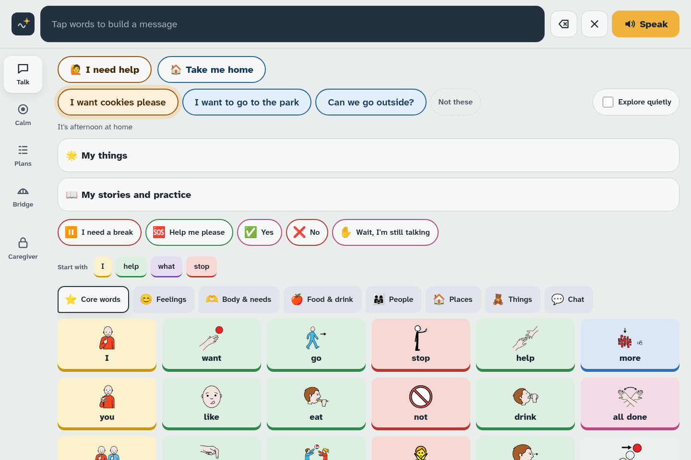 | 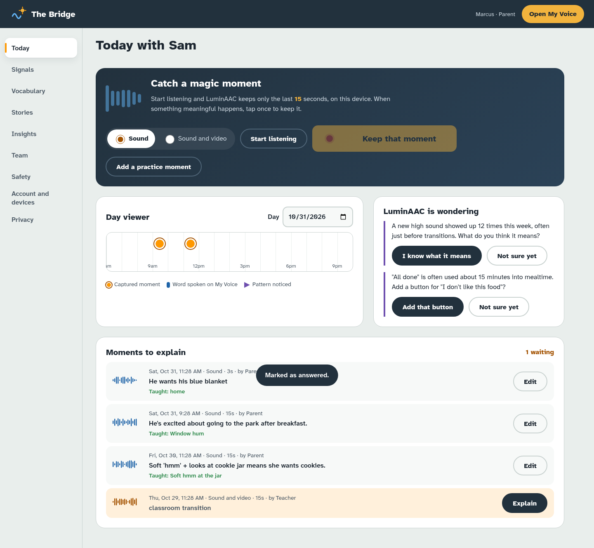 |
| **Signal library** | **Feeling estimates** |
| 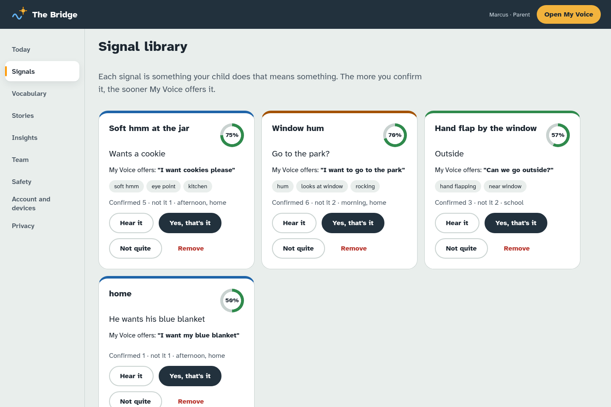 | 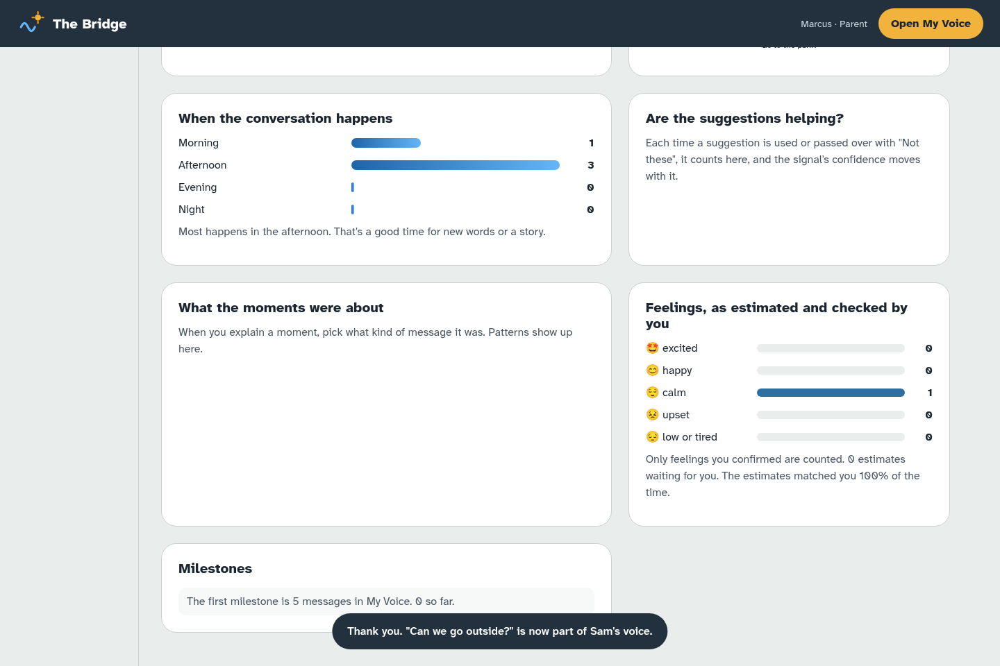 |
| **Water danger zones** | **Drawing a zone by hand** |
| 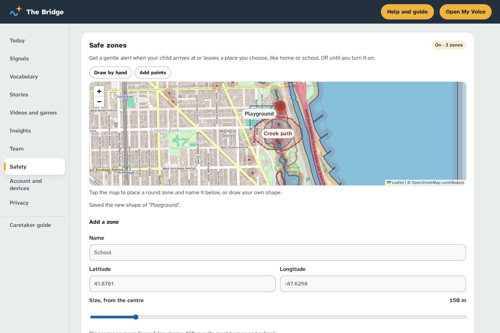 | 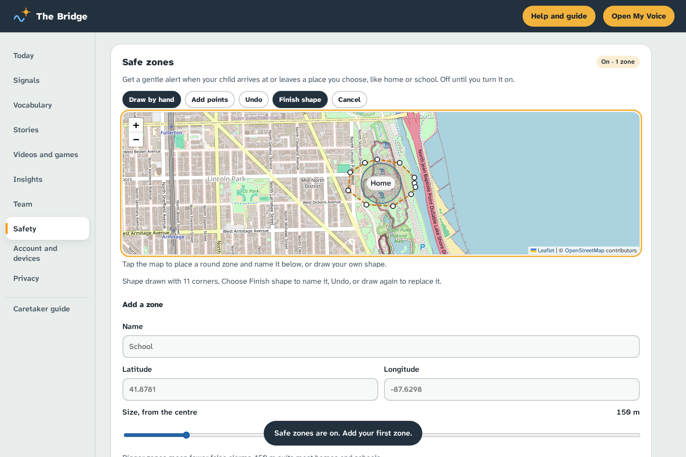 |
| **Video board (Bridge)** | **Interests and history** |
| 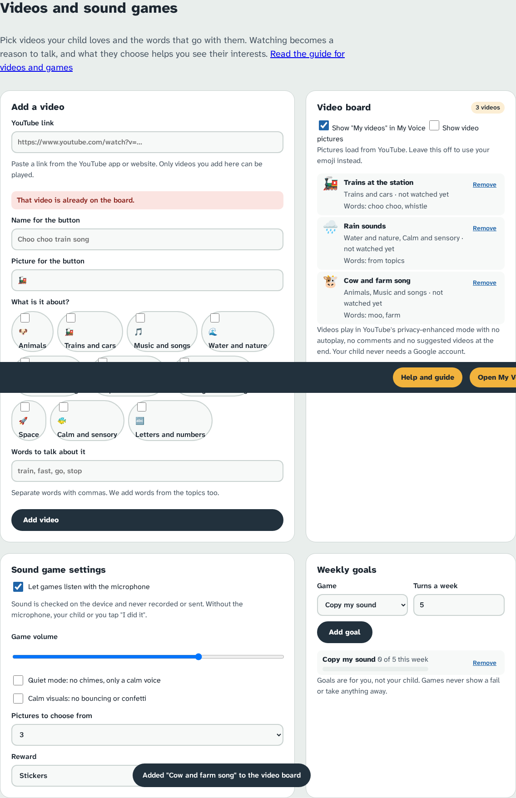 | 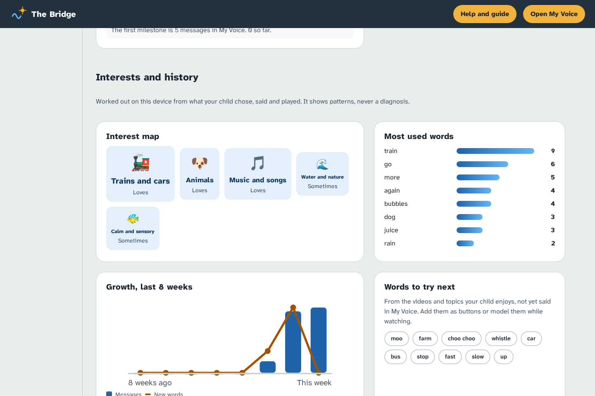 |
| **Sound game: copy my sound** | **Therapist summary** |
| 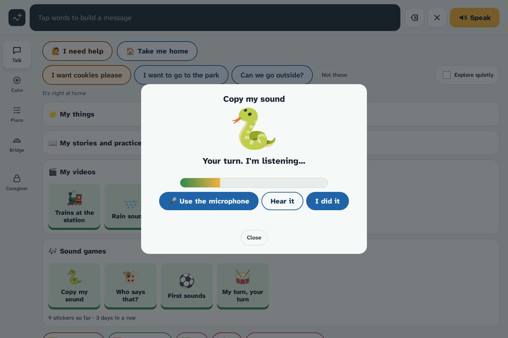 | 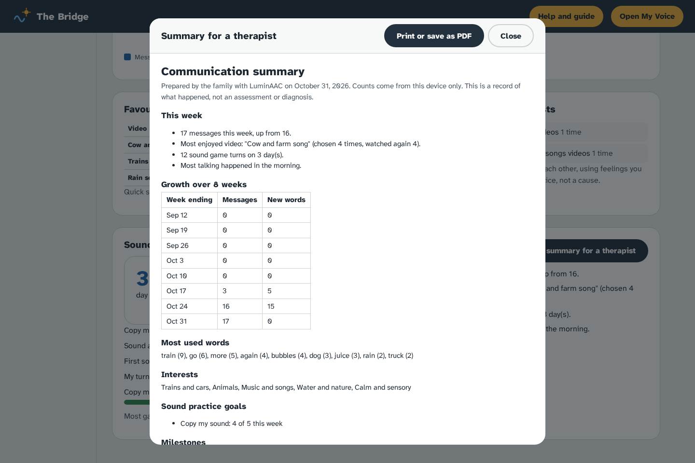 |
| **Caretaker guide** | **On a phone: talk about a video** |
| 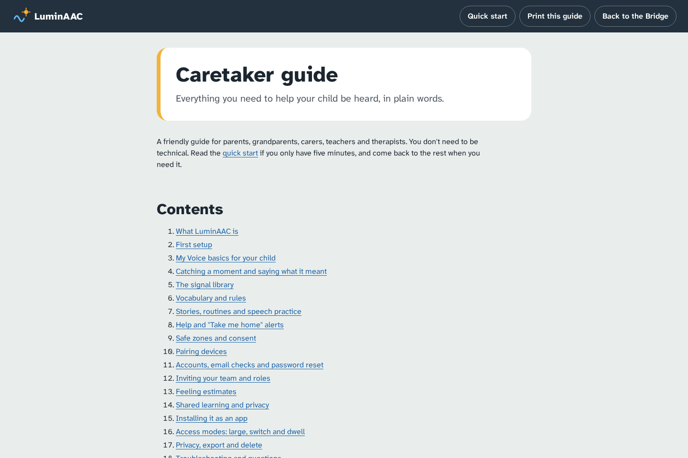 | 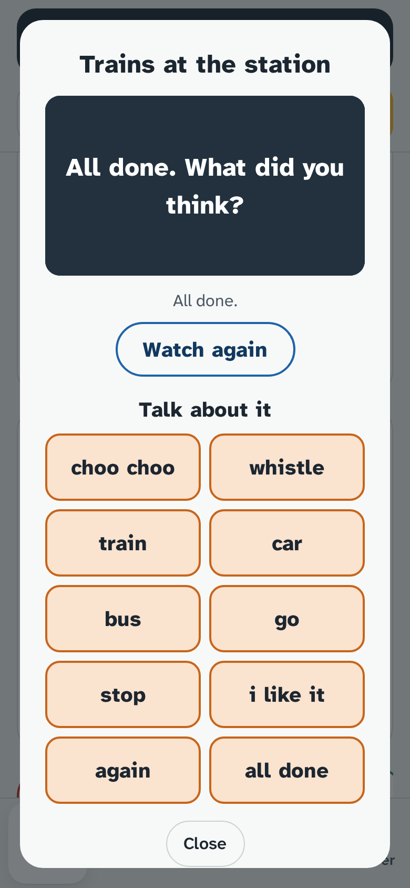 |

## Feature map

| Phase | Version | What it added |
|---|---|---|
| 1 | v0.3 | Magic-moment rolling buffer, annotation studio, signal library with confidence, proactive suggestions, My things, explore mode, day viewer, vocabulary rules, insights and personality map, role-scoped sharing, privacy controls, onboarding, logo set |
| 2 | v0.4 | Help and "Take me home" alerts that reach the Bridge live, social stories and first/then routines, speech practice with rewards, Large/Playful/Focus modes, dwell and switch scanning, Node backend for sync, share links and alerts |
| 3 | v0.5 | Safe zones with consent (Leaflet/OSM), device pairing by QR or code, accounts with scrypt and passkeys, roles and invites, on-device feeling estimates, opt-in federated learning with DP noise and secure aggregation, OpenMoji fallback pictures |
| 4 | v0.6 | Speech-emotion model (transformers.js, WebGPU/WASM), Kokoro natural voices, email confirmation and password reset, dropout-tolerant secure aggregation (Shamir t-of-n), installable PWAs, quiet-device alert, Capacitor scaffold, vendored face estimate |
| 5 | v0.7 | Caretaker guide (Markdown and printable web page with a quick-start one-pager), open-source repository files |
| 6 | v0.8 | Water danger zones from OpenStreetMap (Overpass) with a tunable buffer and urgent alerts, freehand safe and danger zones drawn by finger or stylus (pressure, palm rejection, simplification), shape editing with keyboard support |
| 7 | v0.9 | Caregiver-chosen video board with a locked-down privacy-enhanced YouTube player and a "Talk about it" board, four gentle sound games (copy my sound with an on-device loudness and pitch meter, sound-to-picture, first sounds, turn-taking) with stickers, streaks, sensory settings and weekly goals, Interests and history insights (interest map, word growth, words to try, mood links) and a printable therapist summary. See [the concept](docs/CONCEPT-INTERESTS-INSIGHTS.md) |
| 8 | v0.10 | **Potty Path**: a toilet-learning and communication module. An always-working "I need the toilet" button, a calm Now/Next step path with a companion, a silent sit timer with a body check and hard caps, add-only tokens and a World that only grows, a one-handed caregiver console with coaching scripts, medical red flags that pause the plan, explainable hints, printable schedule, school and doctor sheets, calendar reminders, QR handoff and opt-in end-to-end encrypted sync. See [the blueprint](docs/POTTY-PATH.md) |
| 9 | v0.11 | **Sound Path and Potty Path mechanics.** Sound Path: a research-checked voice ladder (any voice → long sounds → syllables → words → two words), three games (Sing and Tap, Word Train, Sound World), "Say it with me" after board taps, a grown-up judge bar, an adaptive practice engine (blocked then mixed, fading praise, challenge point), a sound inventory and an SLP sheet. Potty Path: six stages with recommend-then-confirm, signal timing (telling first earns most; late tellings are thanked but never paid better), a pure session planner, a "Next: toilet" card and offer, calm sit activities, token phases with reward choice, and fading (World book, progress sheet). See [Sound Path](docs/SOUND-PATH.md) and [the mechanics review](docs/POTTY-PATH-MECHANICS.md) |
| 10 | v0.11.1 to v0.11.4 | **Redesign R1** (on by default since v0.13; `?redesign=0` for the older tabs). Five Bridge hubs (Home, Programs, Progress, Circle, Safety) over the 12 tabs, a scrolling bottom bar on phones and a left rail on larger screens, and old links still work. My Voice gets Talk · Calm · My day · Play, a Now/Next ribbon and the Bridge link inside the Caregiver area. Fast water search reads the water colour from OpenStreetMap tiles in seconds, then swaps in named Overpass results, asking all mirrors at once. See [the redesign proposal](docs/REDESIGN.md) |
| 11 | v0.12 | **Family server on Vercel** (`api/index.js`, data mirrored to Upstash Redis by `backend/mirror.js`). **Team chat** for parents, teachers, therapists and family. **Sensors and wearables**: private webhook links for door, gate, pool and bed sensors (IFTTT, Home Assistant) with urgent alerts, plus one-tap tracker buttons. **YouTube channels** next to single videos, playing a channel's uploads in the privacy-enhanced player. Self-reloading updates |
| 12 | v0.13 | **The simpler layout becomes the standard.** Hubs on the Bridge and Talk · Calm · My day · Play on My Voice for every device, the older header fits phones, and a full audit of the docs against the app ([FEATURE-AUDIT.md](docs/FEATURE-AUDIT.md)) |
| 13 | v0.14 | **Reach, privacy and research.** Push alerts and email summaries, family photos and recorded voices on tiles, one- and two-switch scanning, optional end-to-end encryption with device approval codes, a "Say the word" game with on-device listening, a Capacitor 8 native shell with background geofences ([STORE-CHECKLIST.md](docs/STORE-CHECKLIST.md)), and a blind caregiver agreement check with kappa ([VALIDATION-STUDY.md](docs/VALIDATION-STUDY.md)). Sound tags and sign learning are concepts only ([ML-CONCEPTS.md](docs/ML-CONCEPTS.md)) |
| 15 | v0.16 | **Word games**: eight games played with the child's own board tiles in their Talk columns (Word Garden, Conductor, Feelings Weather, Story Stage, Pattern Lab, My Turn Your Turn, Sound Pond, Copy the Robot), an add-only play world, and grown-up settings for movement, sound, rest time and camera. Plus the [DESIGN.md](DESIGN.md) "quiet sky, lit strip" look: a still sky behind words, a dark lantern rail with the open section lit, and a lit hub indicator. See [the games concept](docs/GAMES-CONCEPT.md) |
| 17 | v0.18 | **Motion** (from [the motion concept](docs/MOTION-CONCEPT.md)): one motion gate with a three-step Movement setting; words travel from tile to sentence bar; a breathing Calm sky; slow shader skies in games; five new games (Lantern Sky, Tide Pool, Sound Garden, Aurora Feelings, a 3D Word Train); Bridge counters and sync beam; a scroll-story page, `about.html` |
| 16 | v0.17 | **Sound Path B–D and Safety Links** (from [the Sound Path plan](docs/SOUND-PATH.md)): Watch my mouth (family clips on the device), Mouth Mirror (jaw and lips, camera off by default), Sound and treat; tracker cards with battery reminders, an "if found" QR page with no location, a wandering plan sheet, smart sensor events and the "going out together" door rule; Bluetooth near or far (Android/Chrome); research-mode wristband "calm check?" behind a separate consent; export of labelled sounds |
| 14 | v0.14.2 to v0.15 | **Lock-up fix and shared boards.** Sound games, stories and Sound Path no longer freeze the page after one go (their pop-ups opened inside the hidden Talk view); the microphone is let go when a game closes. **Open Board Format** import and export (.obf and .obz) in the Caregiver area, so boards move to and from CoughDrop, Cboard, AsTeRICS Grid and other AAC apps. |

## Architecture

```mermaid
flowchart LR
  subgraph Child device
    MV[My Voice<br/>index.html] --> SH[(shared.js<br/>localStorage + IndexedDB)]
    MV --> GEO[geo.js<br/>safe zones]
    MV --> SW1[Service worker<br/>offline cache]
    MV --> GM[games.js + interests.js<br/>sound games, history]
    MV -. caregiver-chosen videos only .-> YT[(youtube-nocookie.com)]
  end
  subgraph Caregiver device
    BR[The Bridge<br/>bridge.html] --> SH2[(shared.js<br/>localStorage + IndexedDB)]
    BR --> AI[ai.js + ai-worker.js<br/>speech emotion, Kokoro]
    BR --> EMO[emotion.js<br/>prosody + face]
    BR --> FL[fl-core.js<br/>local training, DP, masks]
  end
  subgraph Family server - Node 18, zero dependencies
    VF[api/index.js<br/>Vercel function] --> API[server.js<br/>sync, alerts, chat, sensors]
    API --> ACC[accounts.js<br/>webauthn.js]
    API --> FLS[flserver.js<br/>FedAvg, Shamir unmasking]
    API --> MAIL[mailer.js<br/>SMTP]
    API --> YTL[youtube.js<br/>channel lookup]
    API --> ST[(store.js<br/>JSON files)]
    VF --> MIR[mirror.js] --> RD[(Upstash Redis)]
  end
  SEN[Sensors, IFTTT,<br/>Home Assistant] -- webhook --> API
  MV <-- sync, alerts, pairing --> API
  BR <-- sync, alerts, share links --> API
  FL -- masked weight deltas --> FLS
  AI -. models, first use only .-> HF[(Hugging Face Hub)]
```

Everything works without the backend. The backend adds sync between devices, alerts, team chat, sensor webhooks, share links, accounts, YouTube channel lookups and federated learning. On the live site it runs at the same address as the app (`/api`).

## Quick start

### Front end (static)

```bash
git clone https://github.com/marcusdax/luminaac-ultimate.git
cd luminaac-ultimate
python3 -m http.server 8080
# open http://localhost:8080 (My Voice) and http://localhost:8080/bridge.html (the Bridge)
```

The microphone, camera and service worker need `localhost` or HTTPS.

### Hosting

The live app at <https://luminaac-web.vercel.app> is deployed on Vercel from `main`, with no build step. Pushing to `main` deploys it.

- `vercel.json` serves the repository root as is, and sends `sw.js` and the web manifests with `Cache-Control: no-cache` so updates reach installed apps. `sw.js` also gets `Service-Worker-Allowed: /`.
- **The family server** runs as one Vercel function, `api/index.js`, and `vercel.json` rewrites every `/api/*` path to it. It is the unchanged `backend/server.js`. Vercel's disk is temporary, so `backend/mirror.js` copies the server's JSON files to and from Upstash Redis around each request (one `HGETALL` per request, and only changed files are read or written). It needs `KV_REST_API_URL` and `KV_REST_API_TOKEN`, which the Upstash integration sets. Without them, `/api` answers 503 except `/api/health` and `/api/youtube`.
- **Hosted limits:** a held-open alert stream can't reach other instances, so the Bridge polls `/api/updates` every 30 seconds while visible (alerts and chat in one call). The quiet-device check runs on requests rather than a timer. Mail stays in the outbox until `MAIL_MODE=smtp` and SMTP settings are added. Optional `YOUTUBE_API_KEY` (YouTube Data API v3) enables @handle lookups and per-video titles when YouTube's public feed is down.
- `.vercelignore` keeps `native/`, `tests/`, `docs/`, `backend/test.mjs`, `backend/data/` and Markdown files (except `PRIVACY.md` and `THIRD-PARTY.md`) off public hosting. `screenshots/` is served because the in-app guide shows them.
- Any static host works for the front end alone. Serve over HTTPS and don't cache `sw.js` long-term. Point the Bridge at your own server under Account and devices.

When you change any shipped file, bump `VERSION` in `sw.js` (currently `luminaac-v0.18.0`) so devices pick up the new copy. When an update takes over, `pwa.js` reloads the Bridge once, and My Voice only while it is out of sight. To rebuild `guide.html` from `docs/CARETAKER-GUIDE.md`, run `python3 tools/mkguide.py` (needs the Python `markdown` package).

### Backend (optional)

```bash
cd backend
node server.js      # Node 18+, no npm install; listens on :3001
```

Then in the Bridge go to Account and devices, keep `http://localhost:3001` as the server address, and create an account (or connect a family key under Privacy, then "Sync, alerts and share links"). Mail settings and environment variables are in [`backend/README.md`](backend/README.md).

### Tests

```bash
cd backend
node test.mjs       # 155 API tests: accounts, passkeys, pairing, mail, alerts, federated learning, chat, sensors, YouTube, Redis mirror
cd ..
node tests/geo-water.test.mjs         # 45 tests: Overpass parsing and racing, map-tile water scan, clipping, danger alerts
node tests/interests-games.test.mjs   # 44 tests: YouTube links, embed lock-down, interest scoring, growth, digest, report, pitch, games
node tests/potty.test.mjs             # 89 tests: Potty Path logic
node tests/sound.test.mjs             # 35 tests: Sound Path ladder, practice engine, mouth shapes, pairing, sound set
node tests/safety.test.mjs            # 27 tests: sensor events, door rule, Bluetooth, calm check, if-found page
node tests/motion.test.mjs            # 54 tests: motion gate, breathing, skies, the five motion games
node tests/nav.test.mjs               # 24 tests: redesign hubs, old links, the switch, Now/Next, back to Caregiver
node tests/play.test.mjs              # 29 tests: the eight word games, play world, tile layout, pose check
node tests/obf.test.mjs               # 17 tests: Open Board Format export, .obz zip, import from other apps
node tests/dialog-guard.test.mjs      # 11 tests: pop-ups can never lock the page
# Browser checks (Playwright, with a static server on :8765):
python3 tests/browser/talk-games.py   # plays every game, story and Sound Path game 3 times; nav must stay tappable
python3 tests/browser/obf.py          # board export and import in the Caregiver area
```

## Project structure
| File | What it is |
|---|---|
| `index.html`, `app.js`, `app.css`, `vocab.js` | My Voice (original board, kept intact) |
| `myvoice.js`, `myvoice.css` | Suggestions, My things, Explore quietly, play-moment buttons |
| `bridge.html`, `bridge.js`, `bridge.css` | The Bridge caregiver portal |
| `access.js` | Access modes, board size, dwell and switch scanning for My Voice |
| `bridge-plus.js` | Bridge phase 2: alert bar, Stories tab, access settings, extra insights, sync and share links |
| `backend/` | Zero-dependency Node API (sync, share, alerts, chat, sensors, predictions, accounts, passkeys, devices, federated learning); `mirror.js` keeps its files in Redis when hosted, `youtube.js` looks up channels |
| `api/index.js`, `package.json` | The family server as a Vercel function at `/api` |
| `bridge-chat.js`, `bridge-iot.js`, `bridge-yt.js` | v0.12: team chat, sensors and wearable trackers, YouTube channels |
| `safety-core.js`, `bridge-links.js`, `found.html`, `found.js` | v0.17 Safety Links: sensor events, door rule, Bluetooth and research-mode rules (tested); "if found" page, wandering plan, going out together, Bluetooth card |
| `play-core.js`, `play.js`, `play.css`, `bridge-play.js` | Word games: rules (tested), the game frame and thirteen games, styles, Bridge settings |
| `motion-core.js`, `motion-gate.js`, `motion.css`, `shader-sky.js`, `shaders/sky.js`, `train3d.js`, `bridge-motion.js`, `about.html`, `about.css`, `hero-wave.js` | v0.18 motion: rules (tested), the gate, board and Calm motion, the one sky shader, the 3D Word Train, Bridge motion, the website page |
| `nav-core.js`, `bridge-hubs.js`, `myvoice-redesign.js`, `redesign.css` | Redesign R1, the default layout (`?redesign=0` for the older tabs): hubs, Now/Next, Play, back to Caregiver |
| `obf-core.js` | Open Board Format (.obf, .obz) import and export, with a tiny zip reader and writer |
| `dialog-guard.js` | Keeps pop-ups visible and closes any that would lock the page (v0.14.2) |
| `bridge-p3.js`, `phase3.css` | Bridge phase 3: Safety and Account tabs, feeling estimates, shared learning |
| `myvoice-p3.js` | My Voice phase 3: safe-zone watching, pairing by QR or code, child-scoped pull |
| `geo.js`, `emotion.js`, `fl-core.js` | Geofence maths, on-device prosody and face estimates, federated learning core (shared with the backend) |
| `water.js`, `water-tiles.js`, `bridge-p6.js`, `phase6.css`, `vendor/simplify.js` | Phase 6: water lookup (map-tile colour scan, then Overpass), clipping, freehand drawing and shape editing, Water card |
| `interests.js`, `games.js`, `bridge-p7.js`, `myvoice-p7.js`, `phase7.css` | Phase 7: interest and history maths, sound games and pitch, Videos and games tab and Insights section, My videos and Sound games |
| `sound-core.js`, `sound-store.js`, `myvoice-sound.js`, `bridge-sound.js`, `sound.css` | Phase 9 (Sound Path): the ladder and practice engine, the local practice log, the child games, the Bridge tab and styles |
| `potty-core.js`, `potty-store.js`, `potty-icons.js`, `potty.js`, `bridge-potty.js`, `potty.css`, `backend/potty.js` | Phase 8 (Potty Path): event-log logic, local store and sync, step icons and companions, the child screen, the Bridge tab, styles, and the server relay |
| `guide.html`, `guide.css`, `tools/mkguide.py` | In-app caretaker guide, built from `docs/CARETAKER-GUIDE.md` |
| `vercel.json`, `.vercelignore` | Hosting setup for the live app and its `/api` function |
| `motion-lite.js` | Restrained motion wrapper around Motion that respects reduced motion |
| `vendor/` | Leaflet, qrcode-generator, jsQR, Motion and OpenMoji (see `THIRD-PARTY.md`) |
| `ai.js`, `ai-worker.js` | Phase 4: transformers.js speech-emotion model and Kokoro voices in a Web Worker (lazy, cached, WebGPU or WASM) |
| `bridge-p4.js`, `myvoice-p4.js`, `phase4.css` | Phase 4 UI: speech model download, live face check, voice preview, install buttons |
| `sw.js`, `pwa.js`, `manifest.webmanifest`, `bridge.webmanifest`, `icons/` | Installable app and offline cache |
| `native/` | Capacitor scaffold for background geofencing (see `native/README.md`) |
| `tests/faces/` | Sample faces from Human (MIT) used by the face tests |
| `shared.js` | Shared data layer (localStorage + IndexedDB), confidence scoring, context ranking |
| `tokens.css`, `brand/brand-tokens.css` | Design tokens and brand palette |
| `brand/*.svg`, `favicon.svg` | Logo set |
| `screenshots/` | Headless Chromium captures (desktop 1440×960, mobile 390×844) |
| Docs | `PRIVACY.md`, `RESEARCH-OSS.md`, `THIRD-PARTY.md`, `PRODUCT-SPEC.md`, `TECH-DESIGN.md`, `DESIGN-SYSTEM.md`, `ACCESSIBILITY.md`, `GO-TO-MARKET.md`, `ROADMAP.md` |

Documentation: [Caretaker guide](docs/CARETAKER-GUIDE.md), [Redesign proposal](docs/REDESIGN.md), [Product spec](PRODUCT-SPEC.md), [Tech design](TECH-DESIGN.md), [Design system](DESIGN-SYSTEM.md), [Accessibility](ACCESSIBILITY.md), [Privacy](PRIVACY.md), [Open-source research](RESEARCH-OSS.md), [Go to market](GO-TO-MARKET.md), [Roadmap](ROADMAP.md).

## Privacy

- **Local first.** Settings and learned signals live in `localStorage` (`luminaac:*`); recordings live in IndexedDB (`luminaac-media`). Nothing leaves the device unless a caregiver turns on sync or creates a family account.
- **The hosted family server.** Synced documents, alerts, team chat and sensor records are stored in Upstash Redis through the Vercel integration. Sensor links and share links are stored only as SHA-256 hashes. Recordings, the toilet log and watch history never go to the server, and team chat is never sent to the child's device.
- **Caregivers decide.** Every feeling estimate and every learned signal needs a caregiver's confirmation before it counts.
- **Opt-in everything.** Safe zones need explicit consent, the speech model and face estimate are off by default, and federated learning sends only clipped, noised and masked weight deltas with a per-device privacy budget.
- **Videos and games.** Only caregiver-added videos and linked channels play, through the privacy-enhanced YouTube player with no autoplay or suggestions. Watch history and game turns stay on the device where they happened; only the video list and game settings sync. The game microphone is optional and never records.
- **Patterns, not diagnosis.** Insights and the therapist summary describe what happened; they never assess or diagnose.
- **Retention and control.** 7, 30 or 90 days or forever, with export, restore and delete-all (moments, signals and video and game history) under Bridge, then Privacy.

Full details in [PRIVACY.md](PRIVACY.md).

## Accessibility

- Targets WCAG 2.2 AA: contrast-checked tokens, visible focus rings, 44 px minimum targets, full keyboard support and screen-reader labels.
- Motor-stable board: buttons never move once learned.
- Large, Playful and Focus modes, board zoom, dwell selection and switch scanning.
- Respects reduced motion. Font: Atkinson Hyperlegible Next.

See [ACCESSIBILITY.md](ACCESSIBILITY.md).

## Tech and third-party credits

Vanilla JavaScript ES modules, Web Audio, IndexedDB, Service Workers, WebAuthn and Web Crypto; a zero-dependency Node 18 backend.

- [Leaflet](https://leafletjs.com) (BSD-2-Clause), and map data and tiles &copy; OpenStreetMap contributors (ODbL), used for the map and the water-colour scan
- [Upstash Redis](https://upstash.com) through the Vercel Marketplace, for the hosted server's storage
- [OpenMoji](https://openmoji.org) fallback pictures (CC BY-SA 4.0)
- [ARASAAC](https://arasaac.org) pictograms by Sergio Palao, Government of Aragón (CC BY-NC-SA 4.0, optional, loaded from the network)
- [Human](https://github.com/vladmandic/human) by Vladimir Mandic (MIT)
- [Motion](https://motion.dev) (MIT), [qrcode-generator](https://github.com/kazuhikoarase/qrcode-generator) (MIT), [jsQR](https://github.com/cozmo/jsQR) (Apache-2.0)
- [transformers.js](https://github.com/huggingface/transformers.js) and [kokoro-js](https://github.com/hexgrad/kokoro) (Apache-2.0), loaded only when turned on
- YouTube IFrame Player API with the privacy-enhanced host, only for caregiver-chosen videos and channels, and YouTube's public channel feed or Data API v3 for channel lookups (YouTube API Services Terms)
- Atkinson Hyperlegible Next by the Braille Institute (SIL OFL)

Versions, files and licence notes are in [THIRD-PARTY.md](THIRD-PARTY.md).

## Roadmap

Next up: phone notifications for alerts and chat (Web Push), email from the hosted server, redesign R2 (a Log button, role views and a handoff card), a word strip during videos, topic word pages from interests, opt-in weekly summaries for the care team, word-level sound games on the device, photo symbols and recorded caregiver voices, two-switch and row/column scanning, end-to-end encryption of synced data, shipping the Capacitor apps for background geofencing, and validating the speech-emotion model with real caregivers. Longer term: on-device audio embeddings, gesture keypoints and a small per-child classifier. See [ROADMAP.md](ROADMAP.md).

## Contributing

Contributions are welcome, especially from AAC users, families, speech-language pathologists and accessibility experts. Read [CONTRIBUTING.md](CONTRIBUTING.md) and our [Code of Conduct](CODE_OF_CONDUCT.md) first.

## Licence

LuminAAC's own code is released under the [MIT License](LICENSE). Some bundled or optional assets have different licences: OpenMoji pictures are CC BY-SA 4.0 (share-alike), and ARASAAC pictograms are CC BY-NC-SA 4.0 (non-commercial). See [THIRD-PARTY.md](THIRD-PARTY.md#licence-conflicts-to-know-about) before using LuminAAC commercially.
