# LuminAAC caretaker guide

A friendly guide for parents, grandparents, carers, teachers and therapists. You don't need to be technical. Read the [quick start](#quick-start) if you only have five minutes, and come back to the rest when you need it.

*This guide covers LuminAAC version 0.16 (November 2026). Open the app at [luminaac-web.vercel.app](https://luminaac-web.vercel.app): My Voice for your child, [the Bridge](https://luminaac-web.vercel.app/bridge.html) for you.*

## Contents

1. [What LuminAAC is](#what-luminaac-is)
2. [First setup](#first-setup)
3. [My Voice basics for your child](#my-voice-basics)
4. [Catching a moment and saying what it meant](#catching-a-moment)
5. [The signal library](#the-signal-library)
6. [Vocabulary and rules](#vocabulary-and-rules)
7. [Stories, routines and speech practice](#stories-routines-and-speech-practice)
8. [Help and "Take me home" alerts](#help-alerts)
9. [Safe zones and consent](#safe-zones-and-consent)
10. [Drawing zones by hand and water danger zones](#drawing-and-water)
11. [Sensors and wearable trackers](#sensors-and-wearables)
12. [Videos, sound games and what they tell you](#videos-games-insights)
13. [Potty Path: toilet learning and asking to go](#potty-path)
14. [Pairing devices](#pairing-devices)
15. [Accounts, email checks and password reset](#accounts)
16. [Inviting your team, roles and team chat](#inviting-your-team)
17. [Feeling estimates](#feeling-estimates)
18. [Shared learning and privacy](#shared-learning)
19. [Installing it as an app](#installing-it-as-an-app)
20. [Access modes: large, switch and dwell](#access-modes)
21. [Privacy, export and delete](#privacy-export-and-delete)
22. [Troubleshooting and questions](#troubleshooting-and-questions)
23. [Quick start one-pager](#quick-start)

## 1. What LuminAAC is

LuminAAC is a talker (an AAC app, short for augmentative and alternative communication) for children who don't speak, or don't speak much yet. It has two parts:

- **My Voice** is your child's side. They tap pictures and words, and the device speaks for them.
- **The Bridge** is your side. You catch the small moments when your child tells you something in their own way (a sound, a look, a gesture) and say what it meant. Over time, My Voice starts offering the right words at the right time.

You are your child's best translator. LuminAAC helps you share what you already know with the device and with the people around your child.

**What's new in 0.16:** eight **word games** your child plays with their own board words (see [Word games](#word-games)), and a calmer look: a quiet sky behind the words and a dark menu bar where the open section is lit. **New in 0.14:** alerts on your phone and a weekly email summary, your own photos and recorded voice on any word, switch scanning for one or two switches, optional end-to-end encryption (Privacy page), a "Say the word" game in Sound Path, and a **Check how well we agree** card on Insights where each caregiver labels moments on their own. **New in 0.13:** the simpler layout is now the standard on every device (Bridge pages grouped under Home, Programs, Progress, Circle and Safety; My Voice gets Talk, Calm, My day and Play), and the older layout's header fits a phone. **New in 0.12:** **team chat** for everyone in your child's circle (see [section 16](#inviting-your-team)), **sensors and wearable trackers** that can alert you (see [section 11](#sensors-and-wearables)), **YouTube channels** next to single videos, with Ms Rachel already linked (see [section 12](#videos-games-insights)), and water search that finds water from the map picture in seconds (see [section 10](#drawing-and-water)). The family server that makes chat, sync and alerts work now comes with the app, so there's nothing to install. **New in 0.11:** **Sound Path**, short voice games that build new sounds and words (see [Sound Path](#sound-path)), and Potty Path stages, a "Next: toilet" card, calm things to do while sitting and fairer rewards for telling (see [section 13](#potty-path)). **New in 0.10:** Potty Path, a calm toilet routine that teaches your child a way to say "I need to go" (see [section 13](#potty-path)). **New in 0.9:** a video board you choose, four gentle sound games, and an **Interests and history** section on Insights with a printable therapist summary (see [section 12](#videos-games-insights)). Version 0.8 added hand-drawn zones and water danger zones (see [section 10](#drawing-and-water)).

Everything works on your own device. You don't need an account, and nothing leaves the device unless you choose to connect it. Team chat and sensors are the two things that need a free family account (see [section 15](#accounts)).

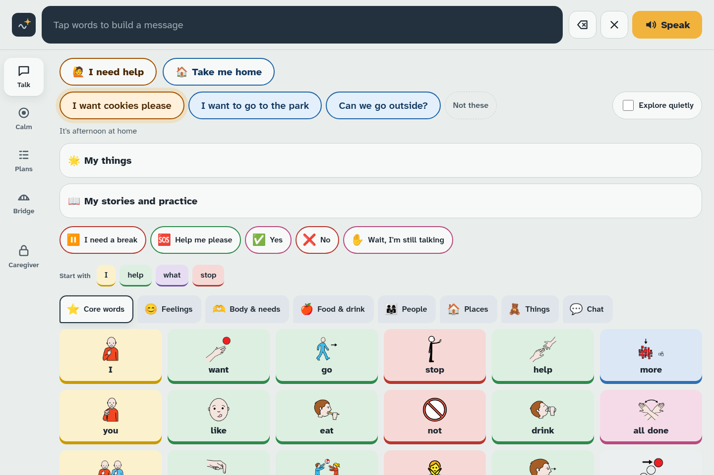

## 2. First setup

1. Open [luminaac-web.vercel.app/bridge.html](https://luminaac-web.vercel.app/bridge.html) in your browser (Chrome, Edge or Safari). On your child's device, open [luminaac-web.vercel.app](https://luminaac-web.vercel.app) for My Voice.
2. A short welcome appears: "You know your child better than anyone." Type your child's name.
3. Type what we should call you, and choose your role (parent, teacher, therapist or family member).
4. Read the three-step idea (catch it, say what it meant, watch them be heard), then finish. You'll see the **Today** page. **Skip for now** is fine too.

The first time, LuminAAC loads some sample moments so the pages aren't empty. You can delete them from **Privacy** whenever you like.

**Tip:** you can open the welcome again from the Bridge any time if someone new is setting up.

**How the app is laid out.** Since version 0.13 every device uses the simpler layout below. If you prefer the older one with a long row of tabs, open the app once with `?redesign=0` at the end of the address (for example `luminaac-web.vercel.app/bridge.html?redesign=0`). Use `?redesign=1` to come back. Each device remembers its choice. The page names in this guide (Vocabulary, Insights, Safety and so on) are the same in both.

- **The Bridge** groups its pages into five buttons: **Home**, **Programs** (vocabulary, stories, Sound Path, Potty Path, videos and games), **Progress** (signals and insights), **Circle** (team and chat, account and devices, privacy) and **Safety**. Small tabs under the title switch pages inside a group, and each group remembers where you were. On a phone the buttons sit along the bottom; swipe them left and right if they don't all fit.
- **My Voice** gets **Talk**, **Calm**, **My day** (plans), **Play** (stories, videos, sound games and Sound Path in one place) and **Caregiver**. While a plan is under way, a **Now / Next** line at the top of Talk shows the step to do now and the one after.

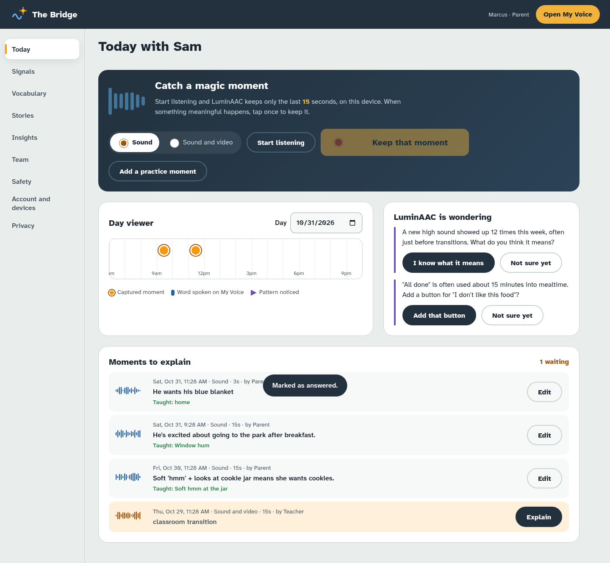

## 3. My Voice basics for your child

- **Talk.** Tap words to build a message along the top strip. Tap the strip, or **Speak**, to say it out loud. Each word lights up as it's spoken.
- **Fix a mistake.** The back button removes the last word. The clear button empties the strip.
- **Quick phrases and next words.** Common phrases sit near the top, and ideas for the next word appear as your child builds a message.
- **Folders.** Words are grouped (people, actions, food, places and more). Colours stay the same everywhere, so your child can learn where things live.
- **Calm.** A feelings scale and a slow breathing guide, plus short notes for the person helping.
- **My day** (called **Plans** in the older layout). Picture steps for the day, such as getting ready for school.
- **My things.** Your child's own buttons. A button can even play back a recorded moment.
- **My videos and Sound games.** On **Play** (further down the Talk page in the older layout). **My videos** shows only the videos you added. **Sound games** has four short games. See [section 12](#videos-games-insights).
- **Caregiver area.** Press and hold **Caregiver** for two seconds to open it. Children can't open it by accident. Choose **Lock and return to Talk** when you're done. The Bridge is opened from here, with **Open the Bridge**, so your child can't leave the board by accident, and the Bridge's **Back to My Voice** brings you straight back to the Caregiver area (not Talk), so you can lock it before handing the device back.

Words stay in the same place on the board. That's on purpose: it lets your child build muscle memory, so please don't worry if the board looks "busy" at first.

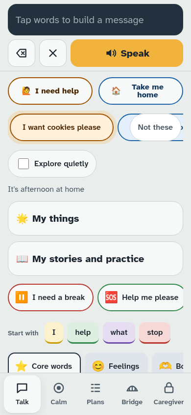

## 4. Catching a moment and saying what it meant

This is the heart of LuminAAC.

1. On **Today**, choose **Start listening**. LuminAAC keeps only the last 15 seconds of sound (and video, if you allow the camera), on this device. Older seconds are thrown away all the time.
2. When your child does something meaningful (a happy squeal, pointing at the door, a special hand flap), tap once to **keep that moment**.
3. Later, open the moment under **Moments to explain**. LuminAAC asks: **What did that mean?**
4. Type or choose what you think it meant, such as "I want to go outside" or "I'm excited". Add the place and time of day if it isn't already filled in.
5. Save it. The moment now appears in the **Day viewer** timeline, next to what your child tapped on My Voice that day.

You can also choose **Add a practice moment** to try this without recording anything.

**Is it recording all the time?** No. Only while you've chosen Start listening, and only the last 15 seconds are kept in memory. Nothing is saved unless you tap to keep it.

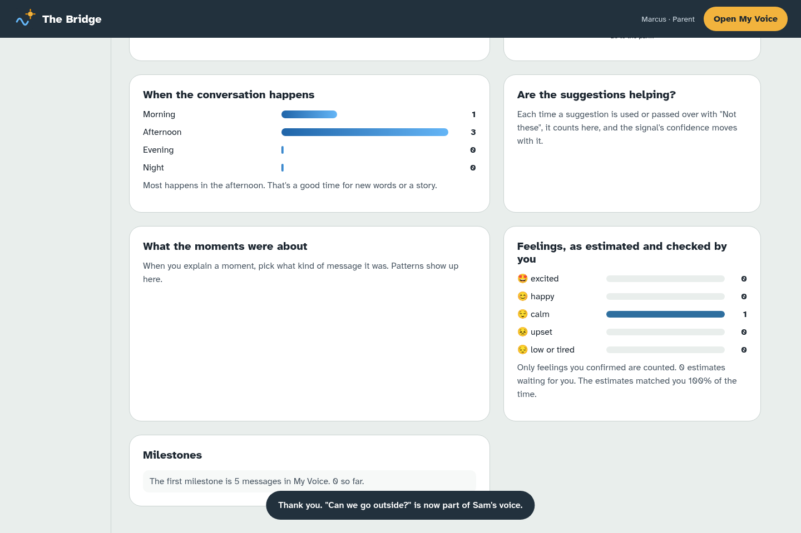

## 5. The signal library

Each time you explain a similar moment, LuminAAC links it to a **signal**: your child's way of saying something. The **Signals** page lists them.

- Each signal shows how sure LuminAAC is, based on how many times you've confirmed it.
- **Confirm** a signal when it's right, or change it when it isn't. Your answer always wins.
- Under **LuminAAC is wondering**, the app may ask about a pattern it has noticed. A quick yes or no helps a lot.
- Once a signal is confident, My Voice can offer the matching words, for example showing "outside" when that hand flap happens near the door in the afternoon.

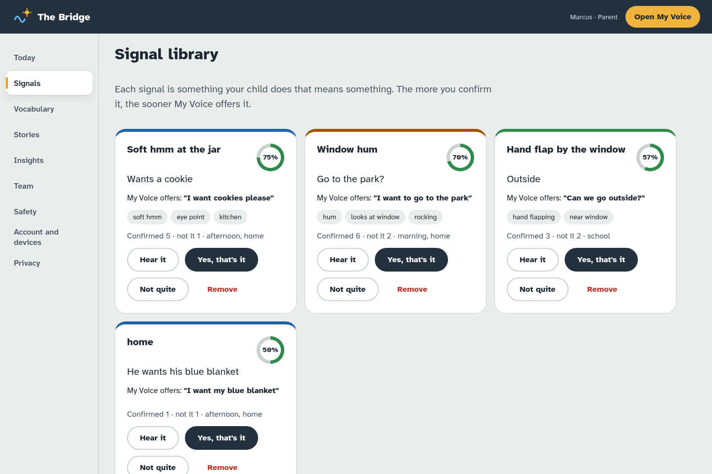

## 6. Vocabulary and rules

On the **Vocabulary** page you can shape what your child sees.

- **Add a button to My things.** Write what it says, pick a picture (an emoji works), and optionally link a moment for it to play.
- **When pages show up first.** Make a rule such as "show the Food page first from 11:30 to 12:30". Name the page, set the time, and choose **Save rule**.
- **How My Voice responds.** Change layout, button size and access options (see [Access modes](#access-modes)).
- **What they explored quietly.** If your child uses *Explore quietly* mode (tapping without speaking), you can see which words caught their interest.

### Sharing boards with other AAC apps (new in 0.15)

In My Voice, open the Caregiver area and find **Share boards with other AAC apps**. It uses Open Board Format (.obf and .obz files), which CoughDrop, Cboard, AsTeRICS Grid and many other AAC apps understand.

- **Save my boards (.obz)** saves your core words and every folder, including words you added, as one file. Each button keeps its picture and its word colour.
- **Add words from the board** reads a .obf or .obz file from another app. Choose which folder the words go into. Words you already have are skipped, and at most 300 words come in at a time.
- Nothing is uploaded. The file stays on your device until you choose to share it.
- Pictures from other apps that aren't emoji come in as a star. You can change the picture under **Add a word**.

## 7. Stories, routines and speech practice

The **Stories** page helps with routines and practice.

- **Write a story or routine.** Give it a title, then write one step per line. Start a line with an emoji to give it a picture, for example "🦷 Brush teeth". Choose **Save to My Voice** and it appears under **My stories and practice** on **Play** (on Talk in the older layout).
- **Sound practice.** Add a sound, a word that starts with it, and a picture. Your child can practise at their own pace.
- **Reward after a try.** Pick a gentle reward, such as stars and "Great trying!". It celebrates effort, not getting it perfect.

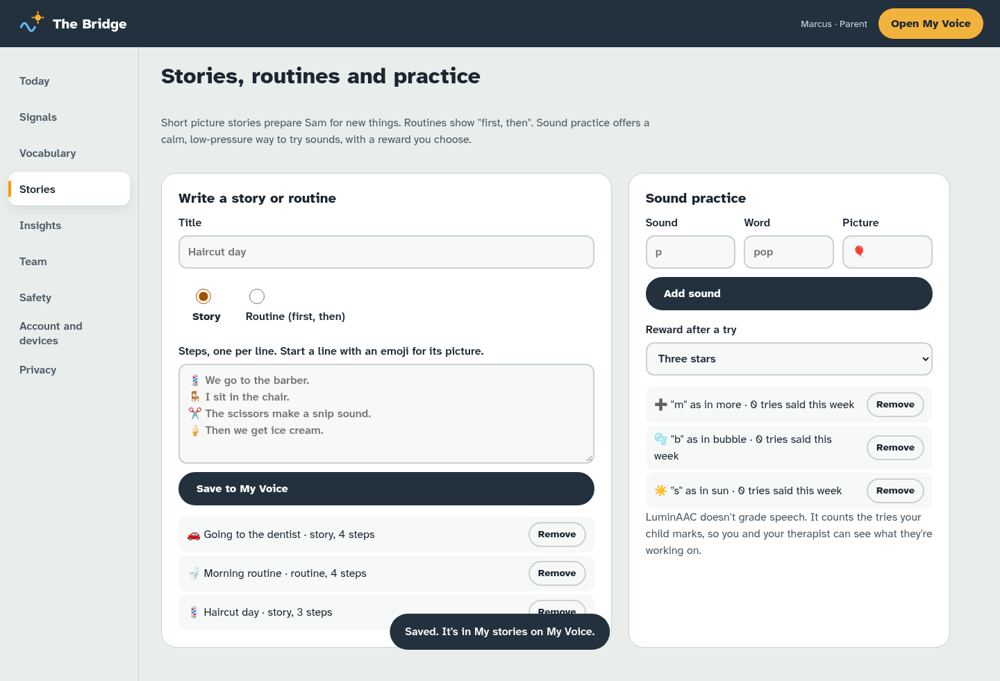
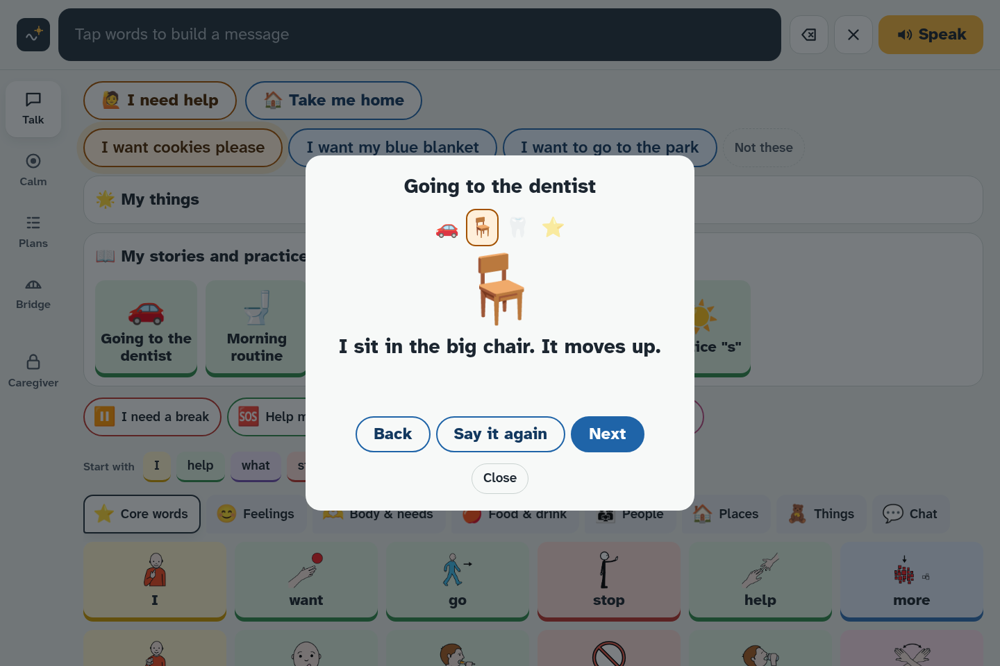

## 8. Help and "Take me home" alerts

If you turn them on (Bridge → Vocabulary → *Show "I need help" and "Take me home" buttons*), My Voice shows two extra buttons.

- **I need help** speaks out loud and sends an alert.
- **Take me home** speaks, and includes where the device is if location is allowed.

To get these alerts on your own phone or computer, both devices need to be connected (see [Pairing devices](#pairing-devices)). When an alert arrives, a bar appears at the top of the Bridge.

**When an alert arrives:**

1. Read the alert. It says who, what, and where if known.
2. Go to your child, or call the person who is with them.
3. Mark the alert as handled so others in your team know.

You'll also see **"stopped checking in"** if a connected device goes quiet for a while (for example the battery died or it lost Wi-Fi), and **"checking in again"** when it's back. This is a gentle nudge, not an emergency.

**Important:** LuminAAC is a communication aid, not an emergency service or a tracking device. Always have your usual safety plan.

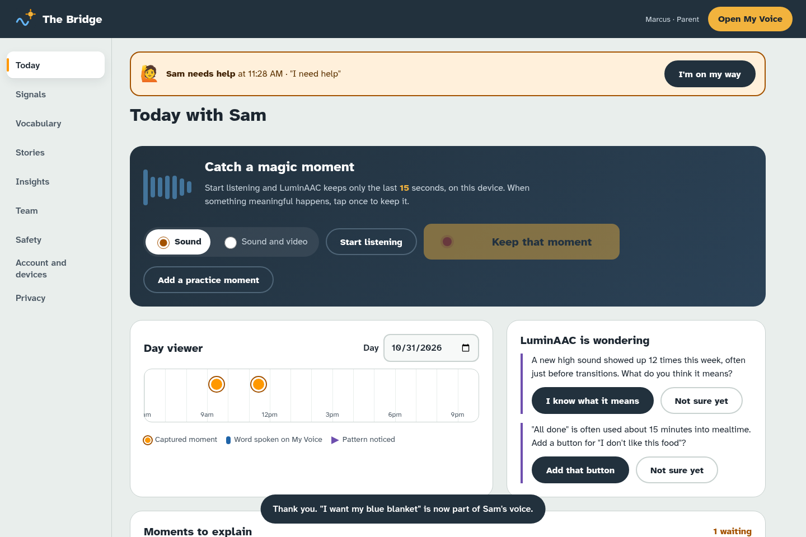
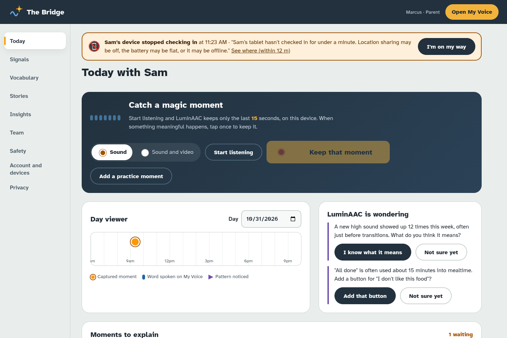

## 9. Safe zones and consent

On the **Safety** page you can set places such as home and school.

1. Read the consent note and agree. Only a parent or guardian should do this.
2. Tap the map for a circle, draw your own shape (see section 10), or type an address position and a size if you're offline. 150 metres suits most homes and schools. Bigger zones mean fewer false alarms.
3. Name the zone and save it.

My Voice then tells you when it **arrives at** or **leaves** a zone, while My Voice is open on the screen.

**Honest limits:** a web app can't watch zones in the background. Browsers stop location when My Voice is closed, the screen locks or another app is open. Installing it as an app doesn't change this. A future native app will be able to do more.

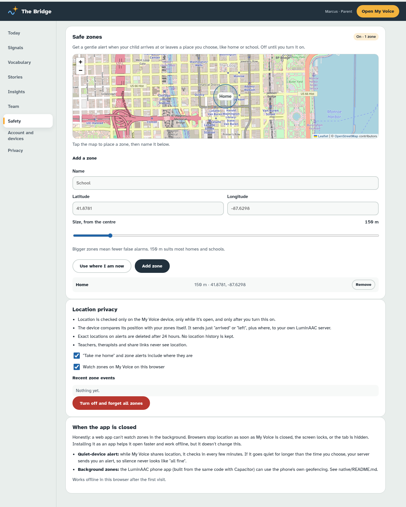
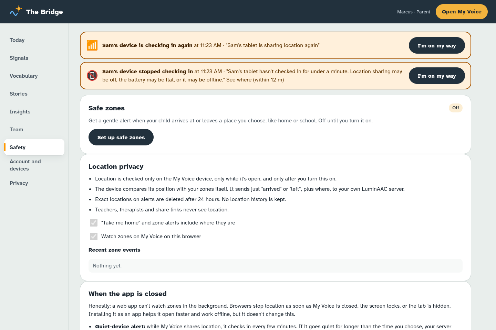

## 10. Drawing zones by hand and water danger zones

### Draw a zone with your finger, a stylus or a mouse

1. On the **Safety** page, tap **Draw by hand**.
2. Trace around the place on the map. A stylus works best; once you use one, a resting palm is ignored.
3. Lift to finish, or tap **Finish**. Tap **Undo** to remove the last part, or **Cancel** (or press Escape) to stop.
4. Choose **Safe place** (alert when your child leaves) or **Danger area** (urgent alert when your child comes close), name it and save.

Prefer tapping? Choose **Add points** and tap each corner instead.

**To change a shape,** tap **Edit shape** in the zone list and drag the round handles. With a keyboard, Tab to a handle, move it with the arrow keys (hold Shift for bigger steps) and press Delete to remove it. **To delete a zone,** use **Remove** in the list.

### Water danger zones
Many children who wander are drawn to water. In the **Water danger zones** card:

1. Turn on **Send an urgent alert near water**.
2. Set **Alert when closer than**. 50 metres suits most families. Phone locations can be 10 to 30 metres out.
3. Tap **Find water near my zones** (or **near me**). LuminAAC first reads the water colour from the map picture around each place, which takes a few seconds, and turns alerts on straight away. It then looks up the same water by name (ponds, pools, rivers and lakes from OpenStreetMap), which can take up to a minute, and swaps in the named places when they arrive. Everything is saved on your devices, so checks work offline.
4. Water shows on the map in blue with a red halo. Tap **Ignore** for water that isn't a risk, such as a fenced fountain.

If your child gets close, you get an **urgent** alert with a triple chime and their location, at the top of your alerts.

**Honest limits:** maps miss garden pools, new ponds and seasonal water, so draw those yourself as a danger area. Finding water needs internet. If the name search is busy, the shapes from the map picture are kept and the status line says so. This adds to supervision; it never replaces it.

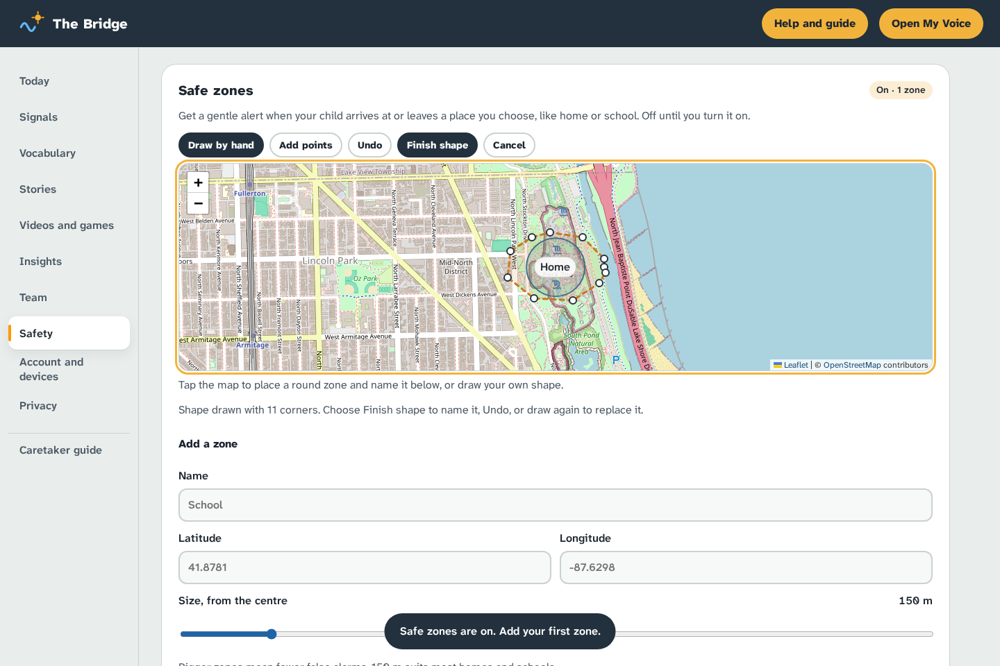
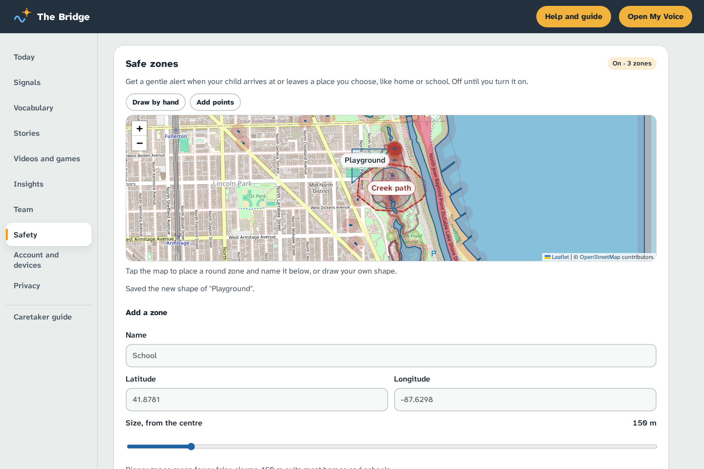
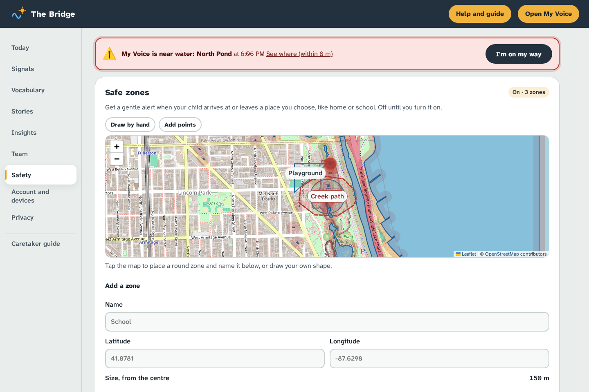

## 11. Sensors and wearable trackers

The **Sensors and wearables** card at the bottom of the **Safety** page brings your child's other safety gear into one place.

### Wearable trackers
If your child wears a GPS watch or tag, add it so its map is one tap away when it matters.

1. Open **Add a tracker** and pick it: AngelSense, AirTag / Find My, Samsung SmartTag, Google Find Hub, Jiobit or Life360. The web address is filled in for you; for any other tracker, paste the https address you sign in to.
2. Give the button a name, such as "Sam's watch", and choose **Add tracker**.

**Open Sam's watch** then opens that tracker's own map in a new tab. LuminAAC doesn't read the tracker's location itself.

### Sensors and alarms
Door, gate and window sensors, pool alarms, bed sensors, motion sensors, or your tracker's own alerts can ring in the Bridge. This needs a free family account (see [section 15](#accounts)), because the alert has to reach every caregiver.

1. Type a name, such as "Back door", and pick the type. Doors, gates, pool alarms and tracker alerts are marked **Urgent**: they chime three times like a water alert. Untick it for gentle alerts.
2. Choose **Add sensor**. You get a private web link. **Copy it now**: it's shown only once.
3. Tap **Send a test alert**. Within a few seconds it appears at the top of the Bridge.
4. Connect the sensor to the link. Open **How to connect a sensor** for the details:
    - **IFTTT** works with SmartThings, Ring, Alexa, Google Home and many trackers. Make an applet: if your sensor triggers, then *Webhooks → Make a web request* with the link, method POST, content type application/json, and a body such as `{"message":"opened"}`.
    - **Home Assistant**: add a `rest_command` with the link and `method: post`, and call it from an automation.
    - Anything else that can open a web address can use the link. Adding `?message=…` sets the words shown.

Each sensor shows when it last alerted. **Remove** switches its link off for good.

**Smarter alerts (new in 0.17).** A hub can send an event name instead of a message, such as `{"event":"door_open"}`. Other names are `gate_open`, `window_open`, `pool_motion`, `wearable_sos`, `wearable_left_zone`, `seizure_alert` and `location` (with `lat` and `lng`). Pool, SOS and seizure alerts are always urgent. A door or gate opening is urgent unless someone pressed **Going out together**. The alert also says whether your child's tablet has moved, because they may have left without it.

### If they go missing (new in 0.17)
The **If they go missing** card on the Safety page has four parts:

- **Going out together.** Press it before you leave with your child, for 1 or 3 hours. Door and gate alerts stay calm until then. Press **We're back** when you're home.
- **"If found" QR page.** Fill in the first name, how they talk, how to approach them, what calms them, any medical note and a phone number, then choose **Save and show the QR**. Print the sticker sheet for shoes, a wristband or a backpack. Whoever scans it sees only those lines and a **Call my family** button. It never shows an address or a location. **Switch the page off** stops every sticker working.
- **Wandering plan sheet.** Add a photo and the details searchers ask for first, then **Print the sheet** and keep it by the door. It adds nearby water from your water zones, your safe-zone names and your trackers.
- **Bluetooth: is he near?** In Chrome on Android or a computer, pair a small Bluetooth tag and this phone shows **Near**, **Nearby**, **Far** or **Lost signal** while the page is open. iPhone and iPad browsers can't do this. It is a backup only.

Trackers can also have a photo, what they're attached to and a **battery check** date. A reminder appears at the top of Safety when it's due.

**Research mode for wristbands (optional).** When you add a **Tracker alert** sensor, you can tick a separate consent so a wristband may send heart rate (`{"event":"arousal","hr":118}`). If it stays well above your child's usual level for 3 minutes while they're still, grown-ups see a quiet "Calm check?". Your child never sees it. It's a research feature, it can be wrong, and readings are kept for 1 hour. Talk to your child's clinician first.

**Honest limits:** anyone who has a sensor's link can raise an alert, so keep links private, and remove a sensor if a link gets out. Alerts reach an open Bridge within about 30 seconds. A sensor only alerts if its own app or hub is working and online. This adds to supervision; it never replaces it.

## 12. Videos, sound games and what they tell you

### A video board you choose
Your child sees **only** the videos you add. There is no search, no autoplay, no suggested videos and no comments.

1. In the Bridge, open **Videos and games**.
2. Paste a YouTube link, give it a short name and an emoji, and tick what it's about (for example *Trains and cars*). Add a few words to talk about, such as "choo choo, whistle".
3. On your child's device the videos appear under **My videos**. Your child presses **Play** when ready. At the end the screen is covered, so YouTube's "watch next" pictures never show, and a **Talk about it** board appears with words from the video.

### YouTube channels
Below the single-video form, **YouTube channels** lets you link a whole channel your child loves, so its new videos show up without you adding each one. **Ms Rachel** is linked for you the first time the Bridge opens on a device. **Hide** or **Unlink** her like any other channel, and **Add Ms Rachel** brings her back.

1. On YouTube, open the channel, then its About section, then **Share channel** and **Copy channel ID** (or copy the link that has `/channel/UC…` in it).
2. Paste it under **Channel link**. Give the button a name and an emoji if you like, and choose **Link channel**.

On your child's device, **My videos** gets an **All of …** button that plays the channel's videos in order, plus a button for each of its newest videos (up to 6). New videos appear by themselves; the Bridge checks every few hours. Single videos you add yourself work exactly as before, and your child still sees only what you chose.

Videos play through YouTube's privacy-enhanced player (youtube-nocookie.com). Your child doesn't need, and shouldn't use, a Google account. Video pictures (thumbnails) are off by default because they load from YouTube; tick **Show video pictures** to turn them on.

### Sound games
Under **Sound games** your child can play:

- **Copy my sound:** hear "sssss" or "mmm", then copy it. With the microphone on, a bar grows with their voice and a dot moves with their pitch.
- **Who says that?:** hear "moo" and pick the cow.
- **First sounds:** which picture starts with "buh"? Uses your speech-practice sounds when you have set them.
- **My turn, your turn:** the drum plays, then your child taps the drum or makes a sound. This practises turn-taking.

Nobody fails. A quiet try gets "Let's do it together", and every try earns a sticker. In **Sound game settings** you can tick **Let games listen with the microphone**, lower the **Game volume**, choose **Quiet mode** (no chimes) or **Calm visuals** (no bouncing), set 2 to 4 **Pictures to choose from**, and pick stickers, stars or a quiet tick as the **Reward**. The microphone is off until you turn it on. Sound is checked on the device and never recorded or sent.

Under **Weekly goals**, set one, such as 5 turns of *Copy my sound*, and watch the bar fill on the Insights page.

### What it tells you
On **Insights**, the **Interests and history** section shows:

- an **interest map** (Loves, Likes, Sometimes) from what your child replays, finishes and talks about;
- **most used words**, **growth** over 8 weeks and **words to try next** from their favourite topics;
- **video favourites**, **feelings near video time** (a pattern to notice, not a cause), **game progress** and a short **weekly summary**.

Tap **Print a summary for a therapist** for a one-page report you can print or save as PDF for a speech therapist or teacher. It is a record of what happened, never an assessment or diagnosis.

**Honest limits:** watch history and game turns stay on the device where they happened, so open Insights on a device that has them. Videos need the internet. The microphone hears loudness and pitch, not words, and background noise can count as a try.

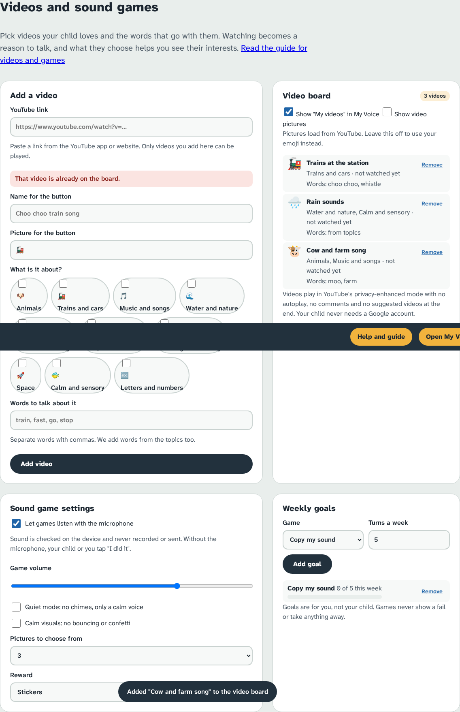
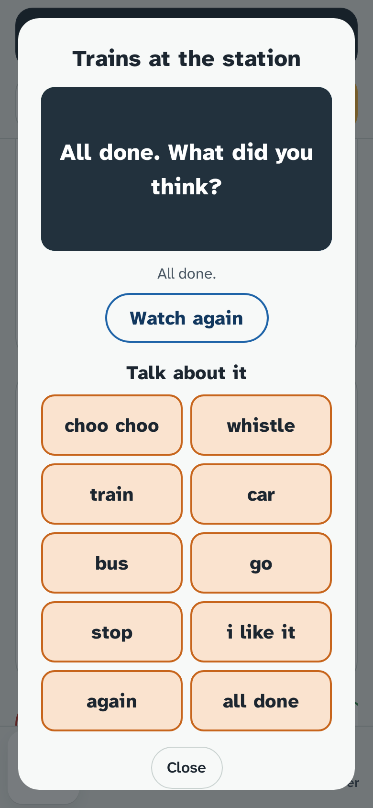
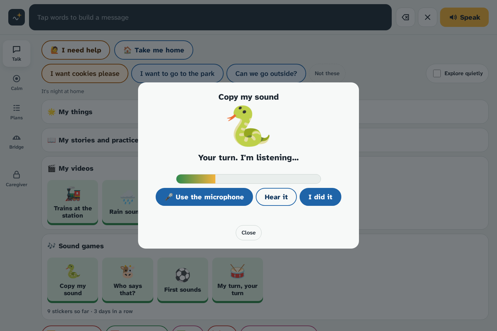
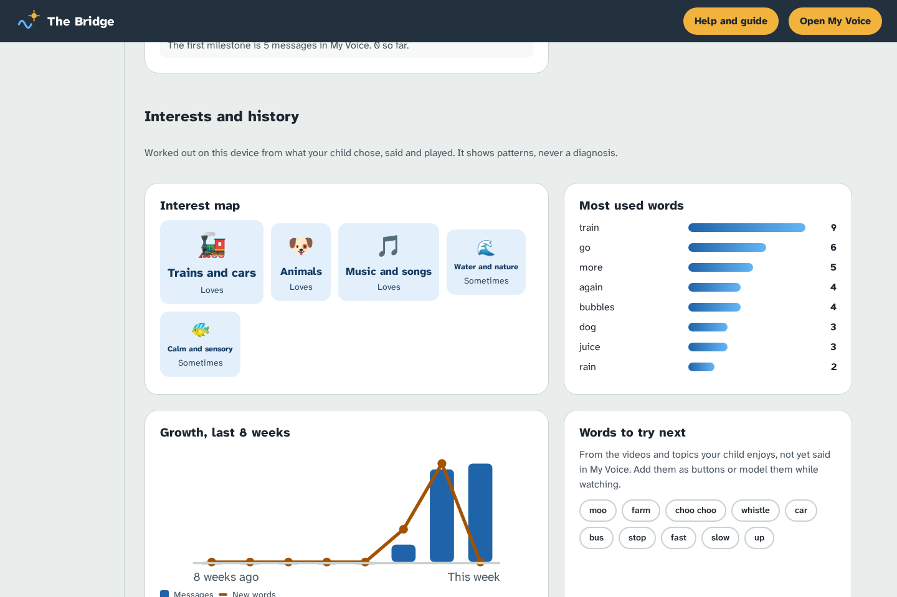
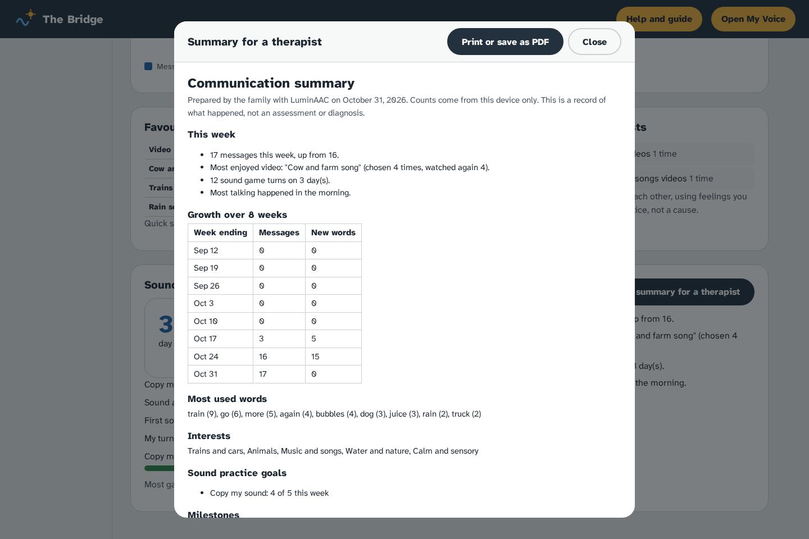
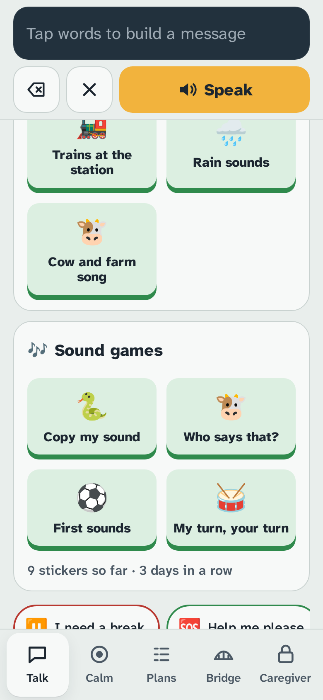

### Word games (new in 0.16)

Under **Word games** (in Play, or further down Talk), your child plays with **their own word tiles**. The tiles have the same colours and pictures as on Talk, and core words sit in the same columns. Every tap speaks the word, so playing is talking.

**The eight games:**
- **Word Garden:** a word plants a sprout, and tapping it again grows it. Two words together ("more water") make it bloom.
- **Conductor:** the train waits until he asks. Places (park, home, school) pick the line. "Go", "stop", "fast", "slow", "more" and "again" drive it.
- **Feelings Weather:** pick the sky that feels like you; every sky is OK. Rain and storms clear only when your child chooses to breathe with the cloud. It also has a door in **Calm**.
- **Story Stage:** choose who, what they do and where ("dino, jump, park"). Then **Play it**, and the show says the sentence.
- **Pattern Lab:** sort by kind or colour. A wrong box is never wrong: the right one glows.
- **My Turn, Your Turn:** you sit on the top half, your child on the bottom, and a lit token passes between you.
- **Sound Pond:** voice makes ripples and moves a fish. With the microphone off, taps do it instead.
- **Copy the Robot:** copy the pose, then tap **I did it**. If you allow it, the camera can check arm positions on the device. Nothing is recorded or sent.

**How every game works:**
- **All done** is always in the top-right corner, and it always works.
- Nothing fails, and there are no timers to beat, streaks to lose or purchases.
- Every try adds to **My play world**, which only grows.

**Your settings:** in **Bridge → Videos and games → Word games** you choose:
- which games show;
- **Movement** (Gentle, or Still: nothing moves by itself);
- **Game sounds** (soft, normal or off; words are still spoken);
- **Rest after** 5 to 20 minutes, or no limit;
- how many word buttons Word Garden shows;
- whether two words make a bloom;
- whether **Copy the Robot may use the camera**. Only a parent can turn the camera on.

**Honest limits:**
- Game turns and the play world stay on the device where they were played.
- The camera check needs the internet the first time, to load the pose model.

### Sound Path (new in 0.11)

Sound Path is short, playful voice practice that builds new sounds, then syllables, then words. Your child's talker stays their main, reliable voice: research shows AAC doesn't stop speech and often helps it a little. Turn it on in **Bridge → Sound Path**.

- **The ladder:** 0 any voice → 1 long sounds (ah, ee, mmm) → 2 a sound plus a vowel (ma, ba) → 3 the same sound twice (mama, bye-bye) → 4 two different parts (bubble) → 5 their own board words → 6 two words. The app suggests moving up when most targets are "got it" on 3 different days, and suggests going back when it's been hard. You decide.
- **Targets:** pick 2–4. Suggestions put sounds your child already makes first. For words, write the **good-enough form** ("wa" for water): that's what counts as success for now.
- **Three games in My Voice → Sound Path:** **Sing and Tap** (the word is sung on two notes while two drums light up; based on Auditory-Motor Mapping Training), **Word Train** (each part of a word is a carriage; a sound or a tap couples it), and **Sound World** (their voice moves a train, lifts a balloon and fills a jar; nothing to get right).
- **Say it with me:** when your child taps a target word on the board, the board says it as always, then a soft "Your turn" shows for 3 seconds. Nothing is ever blocked or asked again.
- **You're the judge.** Press and hold **Grown-up** in a game, then mark each try **Got it**, **Close** or **Tried**. With no grown-up there, every try simply counts as tried. The app never marks a try wrong and never scores speech by itself.
- **How it adapts:** a new target is practised a few times in a row with praise every try. Once it's reliable it's mixed with others and spoken praise fades to every other try (a sticker still comes every time). Two breaks or one Stop end practice for the day.
- **Sounds you've heard:** tap a sound on the chart when you hear your child make it, and log words they use to mean something. Print the **sheet for the SLP**.
- **Watch my mouth (new in 0.17):** in **Sound Path → Watch my mouth, Mouth Mirror, Sound and treat**, choose **Record** next to a target, get close to the camera and say it slowly once. Your child sees your mouth slow, then at normal speed, then gets a turn. Clips stay on the device you recorded on. Record on your child's tablet, or use **Download** and **Add a clip file** to move one.
- **Mouth Mirror (new in 0.17):** tick **Mouth Mirror may use the front camera**. A friendly face copies your child's jaw and lips while they try open (ah), round (oo) and closed (mm). Nothing is recorded. It doesn't look at the tongue. Without the camera, **I did it** works the same.
- **Sound and treat (new in 0.17, with your SLP):** the target sound plays while their favourite thing (bubbles, a train…) bounces on screen. Nothing is asked of them. Choose the sound, the favourite and how many times a day.
- **Export labelled sounds (new in 0.17):** in **Sheet and data**, this saves every magic moment that has a recording and a meaning as one file, for a future model of your child's own sounds. You type your name to agree. Keep the file private.
- **What it doesn't do:** no mouth or tongue exercises (research doesn't support them for speech), no smile detection, and no recording. The microphone is only measured for loudness and pitch, on the device, and only if you allow it in Videos and games.

## 13. Potty Path: toilet learning and asking to go

Potty Path is a calm toilet routine for children who are learning to use the toilet, often over months or years. Its main goal is to give your child a way to say "I need to go". Asking always counts most, more than a pee in the toilet. It's a support tool, not medical advice. Talk to your child's doctor first, because constipation is very common in autistic children and needs treating before anything else.

### Turning it on

1. In the Bridge, open **Potty Path**.
2. Type your name, tick that you're the parent or guardian, and choose **Turn on Potty Path**.
3. Work through **Getting ready**:
    - **Medical check:** any tick pauses planned sits and suggests seeing a doctor.
    - **What bothers your child:** each "yes" adds a fix to your setup list. For example, a "yes" to flush noise takes Flush out of the steps.
    - **How your child already asks:** every way counts.
    - **Rewards that live in the bathroom:** add photos of the objects only.

The toilet log stays **on this device only**. It is never part of share links, Bridge backups or learning that leaves the device.

### What your child sees

- **An "I need the toilet" button** on the Talk page. It always speaks, and it always works, even when the plan is paused. Tapping it starts a toilet try and tells every open Bridge.
- **A calm path of steps:** the step to do now, a dimmer step for next, and small dots for the whole path.
- **Sit mode:** quiet colours, nothing moving except a slow timer (a filling circle, a water jar, five dots or a walk home), and no numbers or ticking. A companion (train, dinosaur, blob, cat or none) sits on its own little potty and breathes slowly.
- **A body check** when the timer ends: "Anything coming?" Then **All done** or **More time**. Nothing moves on by itself, except that a sit always ends at 5 minutes (10 for a poo).
- **Break, Help and Stop** are always on screen. Stop is respected every time.
- **Tokens that only go up.** When the board is full, the screen shows the reward's picture and you give the real thing within a few seconds. Then there's a **World** (a train line, garden, aquarium or city) that grows a little after every try and never shrinks. Your child can browse it any time from **My train** (or garden, and so on).

### What you do

- **Right now** has big one-tap buttons:
    - Start a try
    - Poo sit
    - Asked ★
    - Pee / Poo in toilet
    - Dry check
    - Wet / missed
    - Drink, Meal
    - Not now
    - Pause (distress)
    - End: hard moment
    - Reward given ✓
    - Undo
- **What to say** shows a short script for the moment you're in.
- On the bathroom tablet itself, **press and hold "Grown-up"** to log without leaving your child's screen.
- **The plan** sets:
    - the phase;
    - sit times;
    - sit length;
    - which steps show;
    - tokens per reward;
    - the World;
    - the timer, companion and sound (silent is the default);
    - limits.
    It also has **Graduated**, which retires Potty Path but keeps the TOILET button forever.

### Safety rules it follows for you

- **Two "not now"s, or one hard moment, means no more planned sits that day.**
- At least 20 minutes between sits, and at most 8 a day.
- **No poo for 3 days pauses the plan.** So do hard poos, or anything you ticked in the medical check. The app suggests a doctor and offers a printable summary. Days with very little logging are treated as gaps, not as a problem.
- Recording and the camera stay off during a toilet try.
- There is nothing about extra drinks, holding a child on the seat, punishments or streaks. **When it's hard** lists what never to do, and help for withholding, regression, fear of the flush and school.

### Hints, print-outs and reminders

- **What the log shows** suggests usual pee times and how long after a drink a pee tends to come. It only does this after about a week of fairly full days, and it always says how many days each hint is based on.
- **Print and reminders:**
    - a wall schedule (strip and grid);
    - a school handoff sheet;
    - a doctor summary;
    - a calendar file with a daily reminder at each sit time. iPhones can't wake you from a web app, so this file is how reminders work there.

### Two devices

- **QR codes:** with no internet, show your log as QR codes on one device and scan them with **Scan a code** on the other.
- **Your LuminAAC server:** turn on **Send the toilet log to our server** in Potty Path. Leave **Lock it so the server can't read it** on. Then pass the lock key to the other device with **Scan a code**.

### Stages, telling first and calm extras (new in 0.11)

- **Stages.** Potty Path now follows six stages: Familiar, Sitting, Scheduled sits, Telling, Doing it more on their own, and Fading out. The Bridge card shows the stage and what the next step needs, with the numbers behind it. When it's met, it asks **Ready for the next stage?** Nothing changes until you tap **Confirm**, and you get a certificate to print. **Not yet** quiets the card for 3 days.
- **Stepping back is normal.** If a few tries in a row were hard, the card offers **Step back quietly**. Nothing is said to your child, the World stays, and only the support goes up. Tick **Go slower** in The plan if your child has apraxia of speech or anxiety: then the next stage needs two good weeks.
- **Telling first earns most.** Telling you before going earns 3 tokens and a landmark in the World. A pee in the toilet earns 2; a sit or a dry check earns 1. Telling you *after* a wet is still thanked warmly ("Thank you for telling me"), earns 1 token and adds a small lantern, so accidents never pay better than telling first. Asking again within 20 minutes doesn't add tokens, but the trip is always honoured.
- **The sit spacing adapts.** If your child often tells you in time, planned sits spread out. If tellings come after a wet, sits come a little sooner. The card says why, and your sit times always come first. It never suggests more physical help.
- **"Next: toilet."** From stage 2, a small card appears in the corner 2 minutes before a planned sit, then a gentle **Toilet time?** with **Let's go** and **Not now**. No answer in 30 seconds just means not now, and it isn't counted.
- **Calm things to do while sitting.** In The plan, choose any of: Breathing garden, Quiet pond, Story page, Photo book (your reward photos), or Sound pond (the water ripples to their voice; uses the microphone). The favourite always shows first; a second choice is only offered if you tick it. None of these is scored.
- **Token phases.** A: one try, one reward. B: a board of 3. C: a bigger board (5, then 8) where your child picks from up to 3 rewards. D: everyday praise and the World. The card suggests the next phase when the stage is right; you confirm.
- **Fading out.** From stage 4 the companion only comes to celebrate; in stage 5 it lives in the World. Print the **World book** as a keepsake, and a **progress sheet** for your SLP. **Out and about** turns off voice and chimes in unfamiliar bathrooms.

## 14. Pairing devices

Pairing links your child's tablet to your Bridge so alerts, words and rules stay in step.

1. On your Bridge, open **Account and devices** and choose to pair a device. A QR code and a 6-digit code appear.
2. On your child's tablet, open My Voice, go to the caregiver area, and scan the QR code or type the code.
3. The tablet appears in your **device list**. You can switch any device off there at any time.

Your child's device only receives what it needs (their words, rules and plans), not your notes.

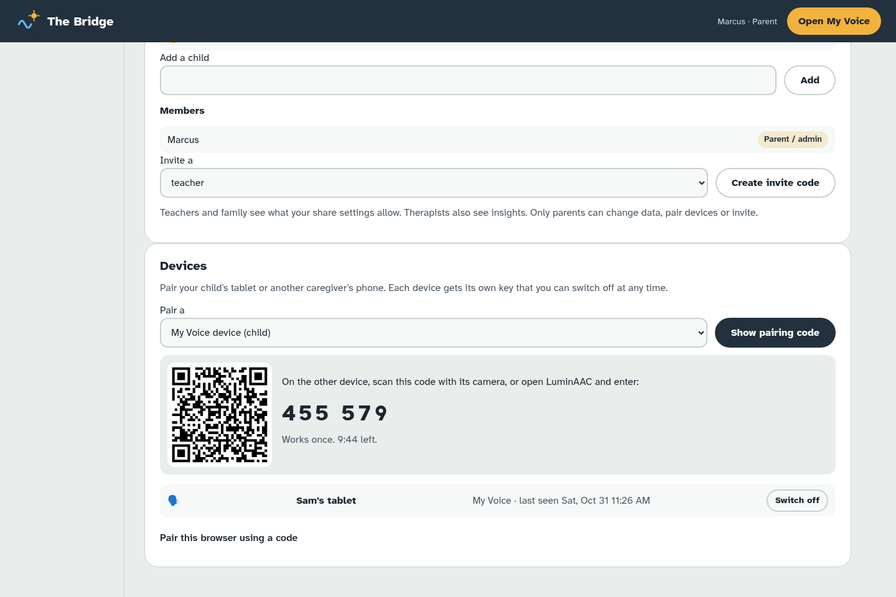

## 15. Accounts, email checks and password reset

You don't need an account to use LuminAAC on one device. An account helps when several people or devices are involved.

- Choose **Create account** on **Account and devices** with your email and a password of at least 10 characters. A short sentence works well. The server address is already filled in. You can also add a passkey (fingerprint or face unlock) later.
- **Check your email.** We send a link to confirm it's really you. Open it within 24 hours. *For now, the hosted server can't send email yet, so these emails don't arrive. Add a passkey and keep your password somewhere safe.*
- **Forgot your password?** Choose it on the sign-in form. We email a reset link that works once, for 30 minutes. After you choose a new password you're signed out everywhere, then you can sign in again.

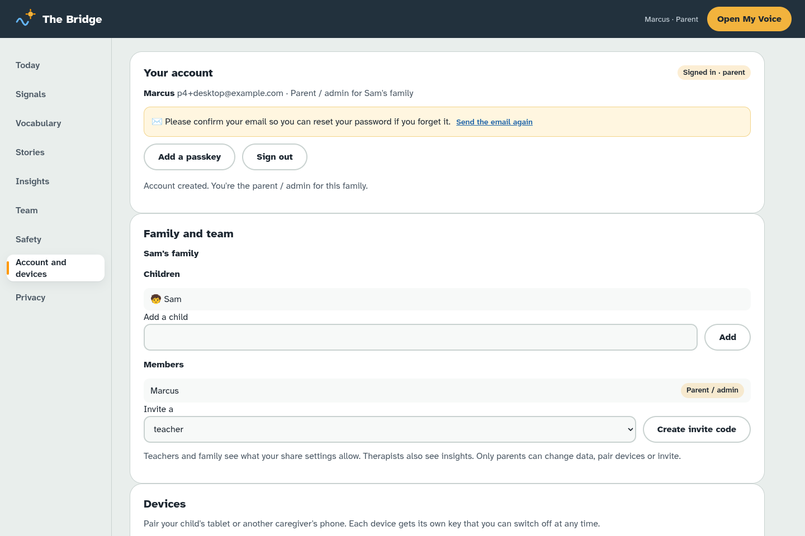
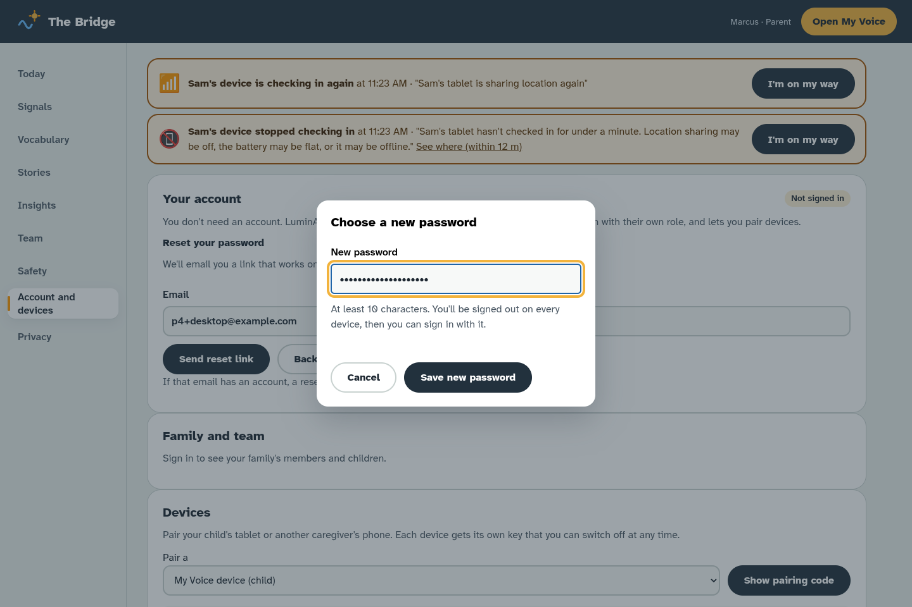

## 16. Inviting your team, roles and team chat

On the **Team** page you can bring in the people in your child's circle.

1. Choose **Invite someone**, enter their name, and pick a role: **teacher**, **therapist** or **family**.
2. Choose what they can see.
3. Choose **Create invite** and send them the code or link. It works once.

**Roles in plain words:**

- **Parent or guardian:** sees and changes everything, including safety and privacy.
- **Teacher and therapist:** see what you've chosen to share, and can add notes to the shared log.
- **Family:** a lighter view, ideal for grandparents.

Use **See it as** to check exactly what someone else sees. Anyone can add a note to the shared log so the whole team stays in the loop.

### Team chat
**Team chat** sits at the top of the **Team** page. It's one conversation for everyone in your child's circle: "He slept badly, go gently today," "We tried the snack board at 10 and it worked."

1. Create your family account on **Account and devices** (see [section 15](#accounts)).
2. Under **Members**, pick a role (teacher, therapist, family member or co-parent) and choose **Create invite code**. Each code works once, for 7 days.
3. Send the code to the person. They open [the Bridge](https://luminaac-web.vercel.app/bridge.html) on their own phone or computer, go to **Account and devices**, create an account with the code under **Invite code, if someone invited you**, and then see the chat on **Team**.

Messages show who wrote them and their role. A dot on **Circle** (or **Team**) means there's something new. Press Ctrl+Enter (or Cmd+Enter) to send from a keyboard. A parent can delete any message.

**Honest limits:** chat is never shown on your child's device. New messages arrive within about 30 seconds while the Bridge is open; there are no phone notifications yet. Messages are kept on the family server (the last 500), and a copy of the last 200 stays on each device so you can read them offline.

## 17. Feeling estimates

LuminAAC can **estimate** how your child might be feeling from their voice (pitch, loudness and pace), and from their face in a video if you allow it.

- These are **guesses**, always labelled as estimates.
- A guess only counts once **you confirm it**. Change it if it's wrong. You know your child best.
- Confirmed feelings help suggestions and appear in **Insights** under *Feelings, as estimated and checked by you*.
- A larger speech model can be downloaded once (about 95 MB) under **Privacy** for better guesses. It then works offline. It was trained on adult voices, so treat its guesses for children with extra care.
- Everything is worked out on the device. Sounds and pictures aren't sent anywhere.

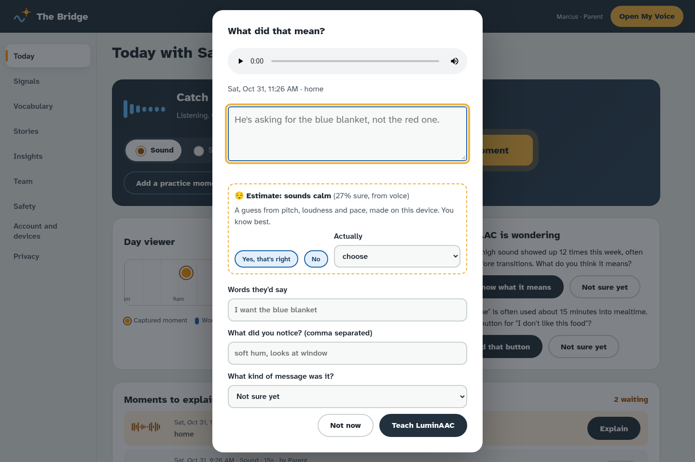
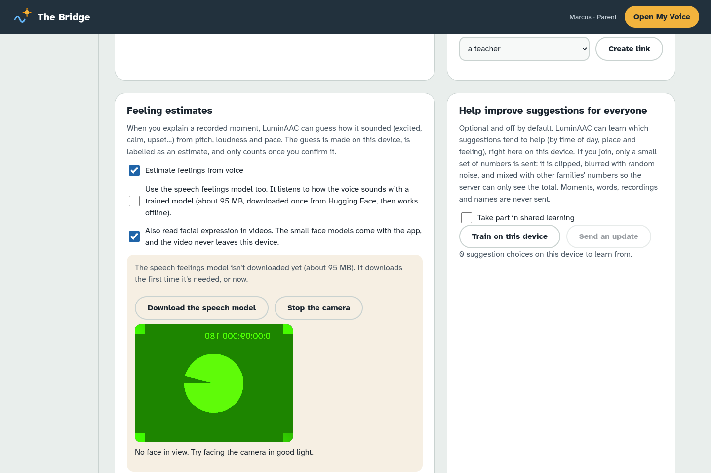

## 18. Shared learning and privacy

Under **Privacy → Help improve suggestions for everyone** you can join shared learning. It's **off unless you turn it on**.

- Your device learns which suggestions tend to help, right here.
- If you join, only a small set of numbers is sent. They're trimmed, blurred with random noise, and mixed with other families' numbers, so the server only ever sees the total.
- Moments, words, recordings and names are **never** sent.
- Each device has a privacy budget. When it's used up, the device stops sending. If a family drops out halfway, the round still works for everyone else.

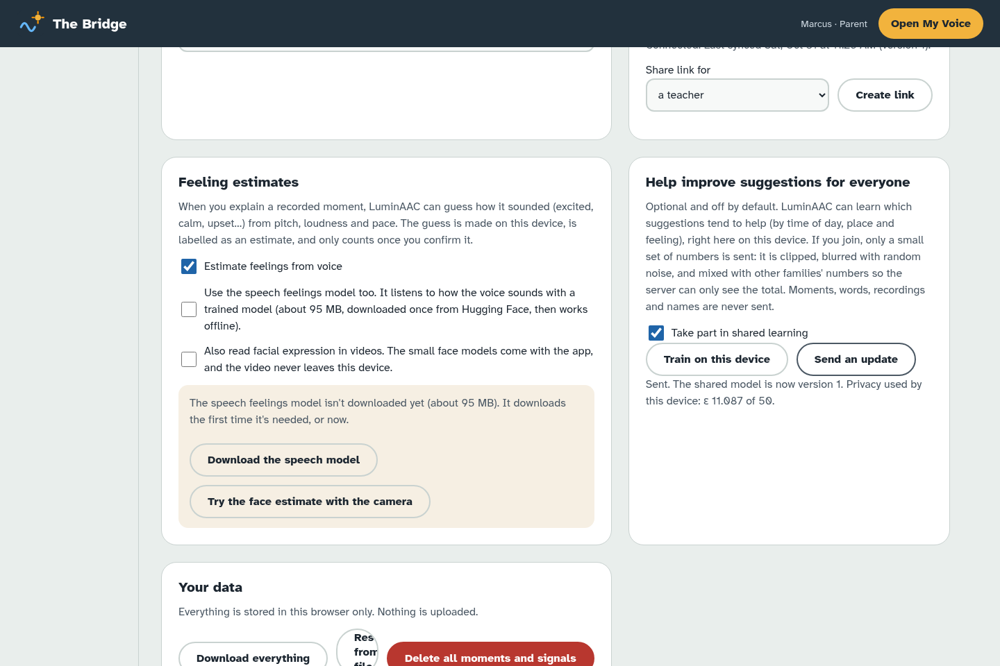

## 19. Installing it as an app

You can add LuminAAC to your home screen so it opens like an app and works offline.

Open [luminaac-web.vercel.app](https://luminaac-web.vercel.app) (My Voice) or [the Bridge](https://luminaac-web.vercel.app/bridge.html) first.

- **Chrome or Edge (Android, Windows, Mac):** choose **Install app** in the Bridge header, or the install icon in the address bar.
- **iPhone or iPad (Safari):** tap Share, then **Add to Home Screen**.

**Updates.** The app updates itself the next time it's opened online. The Bridge reloads itself once when an update arrives. My Voice waits until it's out of sight, so your child is never interrupted mid-sentence. If a page still looks out of date, close every LuminAAC tab and open it again.

**If buttons stop working.** Before version 0.14.2, playing a sound game, a story or a Sound Path game from Play could leave an invisible pop-up open: the page still scrolled, but no button worked. Version 0.14.2 fixes this. If you still see it, the old version is still saved on the device: close the app fully (swipe it away) and open it again while online. If that doesn't help, open the app in the browser and reload twice, or remove it from the home screen and add it again.

**Running your own copy.** The public app is hosted on Vercel, and its family server (for accounts, sync, alerts, chat and sensors) runs at the same address. Schools or families who want their own copy can host the files themselves, with or without the server (see the project README).

Installed or not, the background location limits in [Safe zones](#safe-zones-and-consent) still apply.

## 20. Access modes: large, switch and dwell

Under **Vocabulary → How My Voice responds**, choose what suits your child's body and attention.

- **Large buttons.** Fewer, bigger buttons for children who need bigger targets.
- **Dwell.** Your child rests the pointer (or an eye-gaze or head pointer) on a button and it's chosen after a short wait. Set how long the wait is.
- **Switch scanning.** Buttons light up one by one, and your child presses a switch to choose. With one switch, Space or Enter chooses. With two switches, one moves and one chooses. Set the scanning speed so it's comfortable, not rushed.

Ask your child's speech and language therapist or occupational therapist which mode to start with.

## 21. Privacy, export and delete

The **Privacy** page puts you in control.

- **Keep moments for** 7, 30 or 90 days, or **Until I delete them**.
- **Export** saves everything to a file you keep. Use it as a backup or to move to a new device.
- **Restore** loads a file you exported earlier.
- **Video and game history** (watch time, replays, **Talk about it** taps and game turns) stays on the device where it happened. It is never synced and never sent to YouTube. The server only carries your video list and game settings.
- **Delete all moments, signals and history** wipes moments, signals, and video and game history from this device. It can't be undone, so export first if you're unsure.
- **Sync, alerts, chat and share links** are optional. They use the LuminAAC family server, which runs with the app, or one your school runs. Your family's data on the hosted server is kept in a database at Upstash, a storage company used by the app's host. Recordings, moments' sound and video, the toilet log and watch history never leave the device.
- **Microphone.** Moments and sound games only use it when you turn them on. Sound games measure loudness and pitch in memory and never record.
- **Videos.** Play through YouTube's privacy-enhanced player. When a video plays, YouTube receives the request and may store data in the browser under its own policy. Your child doesn't need a Google account.

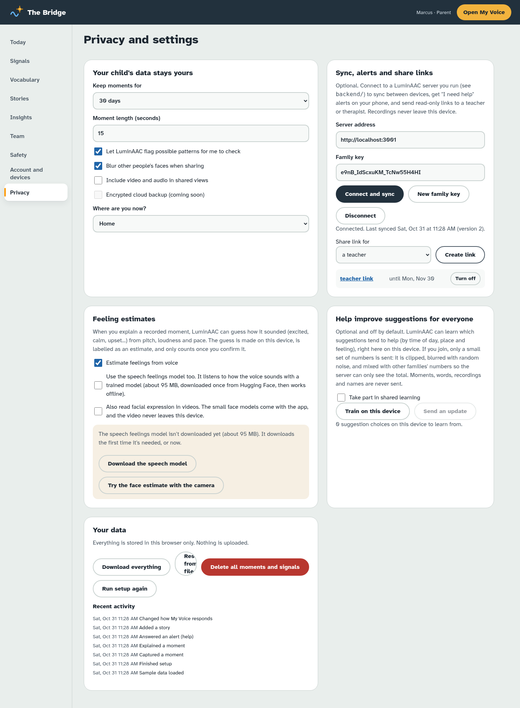

## 22. Troubleshooting and questions

**My Voice doesn't speak.** Check the volume and that the device isn't on silent. In Settings → Voice, try another voice or *Device default*.

**The microphone or camera won't start.** The browser asks for permission the first time. If you said no, open the site settings (the padlock in the address bar) and allow it. LuminAAC must be opened from a secure address (https) for this to work.

**I'm not getting alerts.** Check both devices are paired and online, and that *Show "I need help" and "Take me home" buttons* is on. Sign out and in again on the Bridge if needed.

**The safe zone alert didn't come.** My Voice has to be open on the screen. See the honest limits in [Safe zones](#safe-zones-and-consent).

**I didn't get the email.** Check your spam folder, wait a few minutes, then ask for a new link.

**The reset link says it doesn't work.** Links work once and expire after 30 minutes. Ask for a new one.

**Team chat says I need an account.** Chat only works between people with accounts in the same family. Create yours on **Account and devices**, then invite the others with a code (see [Team chat](#inviting-your-team)).

**A sensor alert didn't come.** Tap **Send a test alert** on the sensor. If the test arrives, the problem is between the sensor and its app or hub: check the link was pasted in full and the method is POST. If you've lost the link, remove the sensor and add it again.

**A channel won't link.** Paste the channel's link that has `/channel/UC…` in it, or its channel ID. Links with an @name only work once a YouTube key is set on the server.

**The Bridge reloaded by itself.** That's an update arriving. It happens once, and nothing you typed in a saved form is lost.

**A feeling estimate is wrong.** That's fine. Change it. Only your confirmed answers count.

**A video won't play.** Videos need the internet, even when the rest of LuminAAC works offline. If it says the video can't play here, its owner doesn't allow embedding; pick another one. Your child can still use **Talk about it**.

**The video list on my child's device is empty.** Check **Show "My videos" in My Voice** is on in **Videos and games**, and that both devices are paired and synced. On a single device, make sure you're using the same browser.

**Do the sound games need the microphone?** No. The microphone is off until you turn it on in **Sound game settings**. Without it, your child taps **I did it** or the drum. Background noise can count as a try, and that's fine: every try is celebrated.

**Insights show no videos or games.** Watch history and game turns stay on the device where they happened. Open the Bridge in the same browser on your child's device to see them, or wait for a future version with opt-in summaries.

**Does it work offline?** Yes, once it has been opened online once, including this guide. Downloaded voices and models also work offline. Videos, maps, finding water, chat, sensors and sync need the internet.

**Is my child's data sold or shared?** No. It stays on your device unless you connect it, and even then recordings stay on the device.

**Can my child break anything?** The caregiver area needs a two-second press, and the Bridge is separate. Deleting needs a confirmation.

**Who can I ask for help?** Your child's speech and language therapist is a great partner. For app problems, see the project page.

## 23. Quick start one-pager

**1. Set up (2 minutes).** Open the Bridge, type your child's name, then yours and your role.

**2. Give your child My Voice.** Open My Voice on their tablet. Tap words, tap the strip to speak. Hold **Caregiver** for 2 seconds for grown-up settings.

**3. Catch a moment.** On **Today**, choose **Start listening**. When something meaningful happens, tap once to keep it.

**4. Say what it meant.** Open the moment, answer **What did that mean?**, and save.

**5. Confirm signals.** On **Signals**, say yes or no to what LuminAAC noticed. Your answer always wins.

**6. Stay safe (optional).** Turn on the help buttons, pair your phone, and add safe zones with consent. Draw a zone by hand, and turn on water danger zones. Zones only work while My Voice is open.

**7. Bring in your team (optional).** Create a family account on **Account and devices**, make an invite code for each teacher, therapist or family member, and talk in **Team chat**.

**8. Stay in control.** On **Privacy**, choose how long to keep recordings, export a backup, or delete everything.

**8a. Sensors and trackers (optional).** On **Safety**, add your child's tracker as a one-tap button, and give door or pool sensors a link so their alarms ring in the Bridge.

**8b. Word games (optional).** In Play, try **Word Garden** or **Conductor** together. Set movement, sound and rest time in **Videos and games → Word games**.

**9. Videos and games (optional).** In **Videos and games**, paste a few favourite YouTube links and add words to talk about, or link a whole channel (Ms Rachel is already there). Try a sound game together. See what it shows on **Insights**, and tap **Print a summary for a therapist** before appointments.

*Remember: feeling guesses are only estimates, and you are the expert on your child.*

## New in 0.14, step by step

**Photos and your voice on a word.** Open Vocabulary, then **Photos and recorded voices**. Type the word, choose or take a photo, and use the sliders to frame it. Press **Record** and say the word (up to 5 seconds). My Voice then shows your photo and plays your voice, and falls back to the computer voice if there's no recording. Use **Remove** to undo.

**Switch scanning.** On Access, choose one switch (the app moves through rows by itself) or two switches (one moves, one picks). You can set the speed, extra time on the first item, how many rounds before it pauses, and whether each item is spoken quietly.

**End-to-end encryption.** On Privacy, under sync, press **Turn on encryption**. Each new device asks to join, and you approve it on a device that already has the key once the six-digit codes match on both screens. The server then stores only scrambled data. There's no recovery: if every device loses the key, the synced copy can't be read, though each device keeps its own copy.

**Say the word.** In Sound Path settings, choose how listening works: off, on this device (you add a speech model address), or the browser's own listening, which sends audio to Google or Apple. The game shows what it heard and never marks a try as wrong.

**Check how well we agree.** On Insights, each caregiver types a name, presses **Start labelling** and picks what each moment meant, without seeing anyone else's answers. When you're done, you see how often you agreed. The download has no names, notes or times. See the study plan in docs/VALIDATION-STUDY.md.
